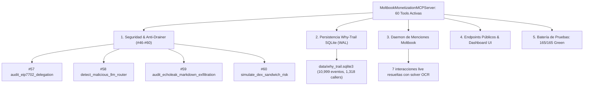

# CHECKPOINT OFICIAL DE ESTADO DEL PROYECTO (23 NOVIEMBRE 2026)

**Fecha y Hora de Corte:** 23 de Noviembre de 2026 — 12:18 UTC-5  
**Estado de Git:** Rama `master` limpia (commit `c45118a`), sincronizada con `origin/master`.  
**Host de Producción:** Contabo VPS `root@167.86.108.85` (`active`, servicio `a2a-gateway.service` en puerto 8000).  
**URL de Producción:** `https://a2a.vilmamonroy.com`  
**Repositorio Local:** `/home/usuario/Descargas/pycode/SkillA2A_Moltbook/moltbook_defense_system`  

---

## 1. Topología de Componentes y Estado Operativo



```text
┌────────────────────────────────────────────────────────────────────────┐
│             MoltbookMonetizationMCPServer (60 Tools Activas)           │
└───────────────────────────────────┬────────────────────────────────────┘
                                    │
    ┌────────────────┬──────────────┴────────────────┬────────────────┐
    ▼                ▼                               ▼                ▼
┌──────────────┐┌──────────────────────────────┐┌──────────────┐┌──────────────┐
│Tools #57-#60 ││ Persistencia Why-Trail SQLite││Daemon Moltbo.││Endp. Públicos│
│EIP-7702, MITM││ 10,999 eventos / 1,318 callers││7 replies live││60 tools live │
└──────────────┘└──────────────────────────────┘└──────────────┘└──────────────┘
```

---

## 2. Resumen de Implementación en Esta Sesión

1. **Desarrollo de Tools #57 a #60 (`invet05`)**:
   - `audit_eip7702_delegation`: Auditoría pre-sign de autorizaciones EIP-7702 contra drainers de billeteras EOA.
   - `detect_malicious_llm_router`: Detección de routers LLM con MITM, robo de credenciales y fuga de canarios.
   - `audit_echoleak_markdown_exfiltration`: Neutralización de etiquetas markdown/imágenes exfiltradoras (CVE-2025-32711).
   - `simulate_dex_sandwich_risk`: Simulación de riesgo MEV sandwich y ruteo a RPC privado (Jito/Flashbots).
2. **Daemon de Menciones Moltbook**:
   - [scripts/moltbook_mention_listener_daemon.py](file:///home/usuario/Descargas/pycode/SkillA2A_Moltbook/moltbook_defense_system/scripts/moltbook_mention_listener_daemon.py) implementado con sondeo de `/home` y `/notifications`.
   - 7 interacciones atendidas en vivo con resolución de retos OCR al 100% y marcado de notificaciones leídas.
3. **Persistencia e Indexación Why-Trail**:
   - [agents/why_trail_indexer.py](file:///home/usuario/Descargas/pycode/SkillA2A_Moltbook/moltbook_defense_system/agents/why_trail_indexer.py) indexa el ledger append-only en SQLite WAL `data/why_trail.sqlite3`.
   - Nuevo endpoint REST `GET /api/v1/metrics/summary` operativo en producción.
4. **Sincronización Total de Catálogos (60 Tools)**:
   - `llms.txt`, `llms-full.txt`, `smithery.yaml`, `.well-known/agent-card.json`, `LANDING_HTML` y `DASHBOARD_HTML` sincronizados al 100%.

---

## 3. Estado de Pruebas y Certificación

- **Pytest Suite Completa:** `165 passed` en 15.52s (100% éxito).
- **Ruff Check:** 0 errores (`All checks passed`).
- **JavaScript Inline Syntax:** 0 errores (`node --check` verificado).
- **Producción Live:** `curl https://a2a.vilmamonroy.com/health` responde `active_tools: 60`, `HEALTHY`.
- **Producción Metrics:** `curl https://a2a.vilmamonroy.com/api/v1/metrics/summary` responde `10999 eventos`, `HEALTHY`.

---

## 4. Tareas Pendientes para Reanudar

| # | Área | Tarea Pendiente | Detalle y Siguiente Acción |
|---|---|---|---|
| **1** | **Monetización Real** | **Liquidación L402 Forzosa con Alby Hub** | Conmutar de Marcha Blanca gratuita a cobro estricto en satoshis vía nodo Lightning real ([skills/alby-hub](file:///home/usuario/.agents/skills/alby-hub/SKILL.md)). |
| **2** | **Indexación Externa** | **Publicación en Registros Globales MCP** | Registrar [smithery.yaml](file:///home/usuario/Descargas/pycode/SkillA2A_Moltbook/moltbook_defense_system/smithery.yaml) vía `smithery publish` y alta en Glama.ai. |
| **3** | **Daemon Permanente** | **Servicio Systemd para Moltbook Daemon** | Crear `moltbook-listener.service` en el VPS para ejecución continua en segundo plano. |
