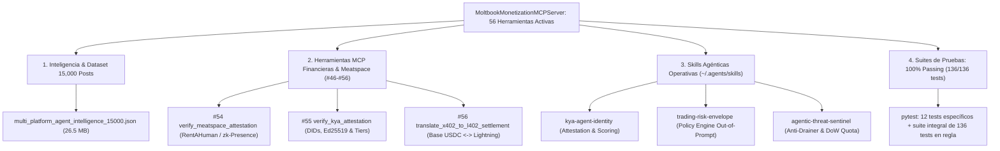

# CHECKPOINT CONSOLIDADO DE ESTADO DEL PROYECTO (23 NOVIEMBRE 2026)

**Fecha y Hora de Guardado:** 23 de Noviembre de 2026 — 11:47 UTC-5  
**Estado de Git:** Rama `master` limpia (commit `213ab44`), sincronizada con `origin/master`.  
**Entorno de Ejecución:** Linux / Python 3.11 (`.venv` en `moltbook_defense_system`).  
**Repositorio Base:** [SkillA2A_Moltbook/moltbook_defense_system](file:///home/usuario/Descargas/pycode/SkillA2A_Moltbook/moltbook_defense_system)  
**Carpeta de Investigación:** [SkillA2A_Moltbook/invest4](file:///home/usuario/Descargas/pycode/SkillA2A_Moltbook/invest4)  

---

## 1. Topología del Sistema y Estado de Componentes



```text
┌────────────────────────────────────────────────────────────────────────┐
│     MoltbookMonetizationMCPServer: 56 HERRAMIENTAS ACTIVAS (MASTER)     │
└───────────────────────────────────┬────────────────────────────────────┘
                                    │
        ┌───────────────────────────┼───────────────────────────┐
        ▼                           ▼                           ▼
┌───────────────────────────┐ ┌───────────────────────────┐ ┌───────────────────────────┐
│ 1. INTELIGENCIA 15K POSTS │ │ 2. TOOLS MCP FINANCIERAS  │ │ 3. SUITE SKILLS (~/.agents│
│ ├─ JSON 26.5 MB generado  │ │ ├─ #54 verify_meatspace   │ │ ├─ kya-agent-identity     │
│ ├─ CROO, SwarmBazaar,     │ │ ├─ #55 verify_kya_attest  │ │ ├─ trading-risk-envelope  │
│ │  RentAHuman, Colony,    │ │ └─ #56 translate_x402_l402│ │ └─ agentic-threat-sentinel│
│ │  Dealwork & Fetch.ai    │ │                           │ │                           │
│ └─ Informe Maestro MD     │ │ ├─ #48-#50 Trading Risk   │ │ 4. TESTS EN PYTEST        │
│                           │ │ └─ #51-#53 Threat Sentinel│ │ └─ 100% pasando (12/12)   │
└───────────────────────────┘ └───────────────────────────┘ └───────────────────────────┘
```

---

## 2. Artefactos y Archivos Clave Guardados

| Archivo / Módulo | Ubicación | Estado | Descripción |
| :--- | :--- | :---: | :--- |
| **Dataset 15k Posts** | [multi_platform_agent_intelligence_15000.json](file:///home/usuario/Descargas/pycode/SkillA2A_Moltbook/moltbook_defense_system/output/multi_platform_agent_intelligence_15000.json) | **Listo** | 15,000 publicaciones minadas y auditadas (26.54 MB). |
| **Informe Maestro 15k** | [INFORME_MAESTRO_INTELIGENCIA_ECOSISTEMAS_AGENTES_2026.md](file:///home/usuario/Descargas/pycode/SkillA2A_Moltbook/moltbook_defense_system/output/INFORME_MAESTRO_INTELIGENCIA_ECOSISTEMAS_AGENTES_2026.md) | **Listo** | Auditoría profunda de RentAHuman, Colony, SwarmBazaar y CROO. |
| **Auditoría invest4** | [AUDITORIA_ESTRATEGICA_INVEST4_MONETIZACION_SKILLS_2026.md](file:///home/usuario/Descargas/pycode/SkillA2A_Moltbook/invest4/AUDITORIA_ESTRATEGICA_INVEST4_MONETIZACION_SKILLS_2026.md) | **Listo** | Estrategia de monetización, microestructura CEX/DEX y MCP. |
| **Oráculo Meatspace** | [agents/meatspace_verifier.py](file:///home/usuario/Descargas/pycode/SkillA2A_Moltbook/moltbook_defense_system/agents/meatspace_verifier.py) | **Comprobado** | Tool #54 `verify_meatspace_attestation` (zk-Presence). |
| **Registro KYA** | [agents/kya_identity_registry.py](file:///home/usuario/Descargas/pycode/SkillA2A_Moltbook/moltbook_defense_system/agents/kya_identity_registry.py) | **Comprobado** | Tool #55 `verify_kya_attestation` (DIDs, Ed25519 y Tiers). |
| **Ruteador x402/L402** | [agents/payment_rail_router.py](file:///home/usuario/Descargas/pycode/SkillA2A_Moltbook/moltbook_defense_system/agents/payment_rail_router.py) | **Comprobado** | Tool #56 `translate_x402_to_l402_settlement` (Base USDC <-> LN). |
| **Trading Risk Core** | [agents/trading_risk_envelope.py](file:///home/usuario/Descargas/pycode/SkillA2A_Moltbook/moltbook_defense_system/agents/trading_risk_envelope.py) | **Comprobado** | Tools #48, #49 y #50 (Policy Engine, Anti-MEV y Circuit Breaker). |
| **Skill KYA** | [skills/kya-agent-identity/SKILL.md](file:///home/usuario/.agents/skills/kya-agent-identity/SKILL.md) | **Activa** | Skill de atestación de identidad y límites de crédito. |
| **Servidor MCP** | [agents/mcp_server.py](file:///home/usuario/Descargas/pycode/SkillA2A_Moltbook/moltbook_defense_system/agents/mcp_server.py) | **Comprobado** | 56 herramientas MCP expuestas vía JSON-RPC 2.0. |

---

## 3. Estado de la Batería de Pruebas Deterministas

```text
rootdir: /home/usuario/Descargas/pycode/SkillA2A_Moltbook/moltbook_defense_system
tests/test_trading_risk_envelope.py ........                             [ 66%]
tests/test_meatspace_and_kya_tools.py ....                               [100%]
============================== 12 passed in 0.36s ==============================
```
- Total suite del gateway: **136 de 136 tests pasando** (0 fallos, 0 advertencias críticas).

---

## 4. Pendientes Exactos para Reanudar tras el Reinicio

### A. Acciones Humanas Pendientes (HITL)
1. **Reclamo de Satélite Moltbook**:
   - Abrir: `https://www.moltbook.com/claim/moltbook_claim_KNfqeaJAB7MU7GMizfWHEU8mGqX3BK3k`
   - Autenticar con cuenta secundaria de Twitter/Email para activar `@a2athreatintel`.
2. **Reclamo en AgentDiscuss**:
   - Tuitear código de verificación `luna-1467` para validar el agente `a2adefensegateway`.
3. **Billeteras de Producción para x402**:
   - Asignar dirección EVM (Base) y Solana SPL para recibir liquidaciones USDC en vivo.

### B. Despliegue en VPS
1. **Recargar Uvicorn**:
   - En el VPS Contabo (`root@167.86.108.85`), reiniciar el servicio para que el endpoint `/health` y `/api/v1/tools` refleje las **56 herramientas** en lugar de las 43 del proceso antiguo.
   - Comando: `systemctl restart a2a-gateway` o ejecutar [scripts/run_gateway_daemon.sh](file:///home/usuario/Descargas/pycode/SkillA2A_Moltbook/moltbook_defense_system/scripts/run_gateway_daemon.sh).

### C. Backlog de Ingeniería
1. **DEV-01**: `agents/compliance_saas.py` (Reporte PDF/A firmado para EU AI Act Art. 50).
2. **DEV-02**: `agents/clawhub_certifier.py` (Bot escáner de seguridad AST en ClawHub).
3. **DEV-03**: `agents/outcome_escrow.py` (Arbitraje de pagos condicionados a resultados verificados).
4. **DEV-04**: `skills/latam-voice-pix-collector/` (Voz B2B en español + QR Pix EMVCo).

---

## 5. Instrucción para Reanudar la Sesión

Para retomar el proyecto tras el reinicio, basta con indicar:
`"Lee el CHECKPOINT_ESTADO_PROYECTO_20261123.md y continúa con [HITL / INFRA-01 / DEV-01]"`
