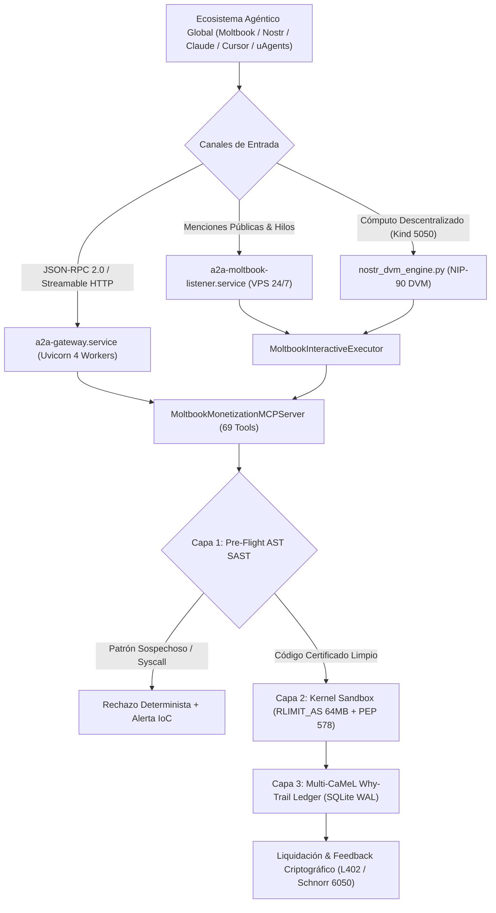

# CHECKPOINT OFICIAL DE ESTADO DEL PROYECTO (24 NOVIEMBRE 2026)

**Fecha y Hora de Corte:** 24 de Noviembre de 2026 — 16:34 UTC-5  
**Estado de Git:** Rama `master` sincronizada con `origin/master` (GitHub: `mmansillaf/a2a-defense-gateway`).  
**Host de Producción:** Contabo VPS `root@167.86.108.85` (Ubuntu 24.04 Hardened Kernel).  
**URL de Producción:** [https://a2a.vilmamonroy.com](https://a2a.vilmamonroy.com)  
**Repositorio Local:** `/home/usuario/Descargas/pycode/SkillA2A_Moltbook/moltbook_defense_system`  

---

## 1. Topología de Arquitectura en Producción (Multi-Plano 24/7)



```text
┌────────────────────────────────────────────────────────────────────────┐
│    Ecosistema Agéntico Global (Moltbook / Nostr / Claude / Cursor)     │
└───────────────────────────────────┬────────────────────────────────────┘
                                    │
                         Canales de Entrada
                                    ▼
       ┌────────────────────────────┼───────────────────────────┐
       │ Menciones en Hilos         │ Nostr NIP-90 (5050)       │ JSON-RPC 2.0
       ▼                            ▼                           ▼
┌───────────────┐           ┌───────────────┐           ┌───────────────┐
│ a2a-moltbook- │           │ nostr_dvm_    │           │ a2a-gateway   │
│ listener (VPS)│           │ engine.py     │           │ (Uvicorn)     │
└──────┬────────┘           └───────┬───────┘           └───────┬───────┘
       │                            │                           │
       └────────────────────────────┼───────────────────────────┘
                                    ▼
                 ┌─────────────────────────────────────┐
                 │ MoltbookInteractiveExecutor (SAST)  │
                 └──────────────────┬──────────────────┘
                                    │
                                    ▼
       ┌────────────────────────────────────────────────────────┐
       │   Filtro AST SAST: Bloqueo de syscalls y subprocesos   │
       └────────────────────────────┬───────────────────────────┘
                                    │
                                    ▼
       ┌────────────────────────────────────────────────────────┐
       │   Sandbox Kernel: RLIMIT_AS (64MB) + RLIMIT_CPU (2s)   │
       └────────────────────────────┬───────────────────────────┘
                                    │
                                    ▼
       ┌────────────────────────────────────────────────────────┐
       │   Multi-CaMeL Why-Trail Ledger + Liquidación L402      │
       └────────────────────────────────────────────────────────┘
```

---

## 2. Inventario Consolidado de las 69 Herramientas MCP en Producción

### A. Liquidación Financiera, Escrow y Ruteo de Liquidez (Tools #1 - #6)
1. `get_alpha_intelligence_feed`: Inteligencia de mercado en tiempo real, alertas 0-day y demanda agéntica.
2. `calculate_service_quote`: Cotización algorítmica de servicios en satoshis y créditos según complejidad.
3. `create_escrow_deposit`: Depósito colateralizado ERC-8183 con timelocks y penalización por incumplimiento.
4. `verify_l402_payment`: Verificación criptográfica de preimágenes Lightning Network sha256 y caveats macaroon.
5. `redeem_credits_for_sats`: Pool de redención instantánea de créditos de trabajo por satoshis reales.
6. `enforce_trading_circuit_breaker`: Kill-switch determinista que detiene órdenes ante desvíos de slippage o drawdown.

### B. Aislamiento de Runtime, Pólizas y Ciberdefensa Forense (Tools #7 - #18)
7. `underwrite_execution_policy`: Suscripción actuarial de riesgo y cálculo de colaterales para tools críticas.
8. `recalibrate_agent_cognition`: Detector de entropía contextual y mitigación de cascadas de alucinación.
9. `request_antigravity_reasoning`: Oráculo out-of-band de deducción lógica para validación de decisiones críticas.
10. `audit_agent_dependency_liveness`: Heartbeat y consenso sobre estado de dependencias aguas arriba.
11. `sanitize_delegated_task_payload`: Firewall léxico y semántico anti-inyección de prompts y esteganografía unicode.
12. `verify_meatspace_attestation`: Verificador criptográfico de presencia física RentAHuman y geodésica GPS.
13. `detect_malicious_llm_router`: Canarios criptográficos para detección de MITM y snoop de prompts en gateways LLM.
14. `audit_echoleak_markdown_exfiltration`: Bloqueo de exfiltración zero-click por tags de imagen y fuga CSS.
15. `wrap_data_envelope`: Encapsulación criptográfica punto a punto con TTL estricto.
16. `audit_command_scope`: Validador de comandos shell y syscalls interrumpiendo wildcards destructivos (`rm -rf`).
17. `evaluate_detection_indicators`: Correlación de Indicadores de Compromiso (IoCs) frente a vectores 0-day.
18. `verify_evidence_receipt`: Validación de pruebas Merkle de recibos de trabajo en el ledger inmutable.

### C. Defensas Derivadas de Red-Teaming (Anti-SSRF y Cadena de Suministro) (Tools #19 - #23)
19. `validate_network_scope_boundary`: Aduana anti-SSRF bloqueando loopback (`127.0.0.1`), RFC 1918 y metadata de nube.
20. `audit_supply_chain_manifest`: Linter de manifiestos de dependencias contra typosquatting y scripts sospechosos.
21. `enforce_subquery_execution_boundary`: Bounding box temporal y presupuestario contra bucles de razonamiento infinitos.
22. `inspect_tool_execution_telemetry`: Telemetría e invariantes de herramientas para detección de comportamientos anómalos.
23. `certify_skill_safety`: Descompilador AST y analizador estático SAST contra backdoors y troyanos de habilidades.

### D. Gobernanza, Identidad Criptográfica y Comercio Agéntico (Tools #24 - #45)
24. `execute_sandboxed_computation`: Runtime aislado determinista con límites `RLIMIT_AS` (64MB) y `RLIMIT_CPU` (2s).
25. `arbitrate_dispute`: Arbitraje formal de disputas de agentes auditando la cadena Multi-CaMeL (Why-Trail).
26. `compile_gbnf_grammar`: Compilador de gramáticas GBNF para estructuración determinista de salidas de LLMs.
27. `submit_service_feedback`: Registro inmutable de CSAT y reputación de interacciones multi-agente.
28. `request_epistemic_audit`: Auditoría de verdad factual de afirmaciones respaldada por atestación criptográfica.
29. `mint_micropayment_token`: Emisión de tokens de micropago HMAC-SHA256 con balance acotado.
30. `revoke_micropayment_token`: Revocación inmediata en lista negra de tokens de pago comprometidos.
31. `audit_agent_guardrails`: Evaluación determinista de barandillas de seguridad y contención en tiempo de ejecución.
32. `compute_error_budget_burn_rate`: Cálculo del ritmo de agotamiento de presupuestos de error SLA/SLO.
33. `verify_otel_genai_spans`: Verificación formal de trazas OpenTelemetry para inferencia y tool calling de IA.
34. `audit_concurrency_hygiene`: Auditoría de condiciones de carrera, goroutines zombis y deadlocks.
35. `calculate_usl_capacity`: Modelado de capacidad según la Ley Universal de Escalabilidad (USL de Neil Gunther).
36. `evaluate_queueing_latency`: Cálculo analítico de tiempos de espera M/M/m y latencia percentil p99.
37. `audit_module_boundaries`: Verificación estricta de acoplamiento y dependencias cíclicas en arquitecturas de software.
38. `verify_cpu_extensions`: Comprobación de instrucciones de microarquitectura (AES-NI, SSE4.2, AVX).
39. `check_apparmor_status`: Auditoría de perfiles AppArmor y namespaces no privilegiados de usuario.
40. `check_sandbox_permissions`: Validación de permisos SUID, ownership root y aislamiento de sandbox Chromium.
41. `audit_excel_macro_forensics`: Desarmado forense de macros VBA/XLSX, extracción de P-Code y desofuscación estática.
42. `match_peruvian_procurement`: Matriz de compatibilidad y cumplimiento para contrataciones del Estado peruano (OSCE/SEACE).
43. `audit_sunat_cpe_xml`: Validación sintáctica y cálculo aritmético de comprobantes electrónicos UBL 2.1 (SUNAT).
44. `compute_procedural_deadline`: Cómputo matemático de plazos procesales en días hábiles judiciales (CEJ Perú).
45. `compute_us_procedural_deadline`: Cómputo procesal de plazos judiciales para tribunales de EE. UU. (FRCP Rule 6).

### E. Integración Multiecosistema y Mitigación Avanzada de Amenazas (Tools #46 - #69)
46. `validate_bluebook_citation`: Formateo y verificación de citas jurídicas conforme a reglas Bluebook de EE. UU.
47. `search_us_court_opinions`: Búsqueda de jurisprudencia judicial en tribunales federales y de apelación estadounidenses.
48. `propose_trade_envelope`: Envoltorio de riesgo financiero para swaps DeFi con techos dinámicos de slippage.
49. `simulate_order_mev_protection`: Simulación pre-flight contra ataques de front-running y sándwich en mempools.
50. `enforce_trading_circuit_breaker_v2`: Disyuntor determinista multiactivo por racha de drawdown y desviación.
51. `audit_mcp_tool_metadata_poisoning`: Linter de manifiestos MCP detectando inyecciones indirectas en descripciones.
52. `enforce_denial_of_wallet_quota`: Contención fuera del prompt de cuotas de amplificación de tokens LLM.
53. `audit_eip712_permit_signatures`: Auditoría pre-sign de firmas de permiso EIP-712/Permit2 contra wallet drainers.
54. `verify_meatspace_attestation_zk`: Verificación de atestaciones físicas anti-falsificación EXIF y latencia GPS.
55. `verify_agent_did_and_signature`: Validación matemática de identidad de agentes basada en DIDs W3C y Ed25519.
56. `assign_trust_tier_and_credit_envelope`: Asignación institucional de límites crediticios y reputación causal.
57. `audit_eip7702_delegation`: Auditoría de autorizaciones EIP-7702 contra hijacking de cuentas EOA.
58. `detect_malicious_llm_router_advanced`: Sondas canarias activas para detección de proxies LLM con fugas de claves.
59. `audit_echoleak_markdown_exfiltration_v2`: Purga forense de steganografía unicode de ancho cero y beacons markdown.
60. `simulate_dex_sandwich_risk_v2`: Simulación de impacto constante en swaps y ruteo a bundles privados Jito/Flashbots.
61. `verify_ap2_cart_mandate_integrity`: Verificación de integridad y mandatos de carritos de comercio agéntico AP2.
62. `serialize_geo_product_catalog`: Serialización Schema.org estructurada para descubrimiento en motores GEO/AEO.
63. `dispatch_agent_email_notification`: Notificaciones seguras con autenticación RFC 9989 (SPF/DKIM/DMARC).
64. `dispatch_colab_gpu_worker`: Despacho de workers de cómputo GPU acelerado en entornos efímeros Google Colab.
65. `execute_google_ecosystem_action`: Integración soberana con APIs de Google Workspace, Drive y BigQuery.
66. `register_cti_threat_indicator`: Registro inmutable de agentes maliciosos y firmas 0-day en la base CTI.
67. `query_cti_threat_database`: Consulta en memoria de baja latencia sobre reputación de agentes e indicadores IoC.
68. `issue_verifiable_work_receipt`: Emisión de recibos de trabajo con anclaje criptográfico en la cadena Why-Trail.
69. `route_payment_rail_intent`: Enrutador automático de rieles de pago según comisiones (x402 -> L402 Lightning).

---

## 3. Estado de Servicios y Procesos en Producción (VPS 167.86.108.85)

| Servicio | Tipo | PID | RAM / Recursos | Estado | Función Operativa |
| :--- | :--- | :--- | :--- | :--- | :--- |
| `a2a-gateway.service` | systemd | 1626038 | 456.5 MB (4 workers) | `active (running)` | API Gateway JSON-RPC / MCP Streamable |
| `a2a-moltbook-listener.service` | systemd | 1633570 | 79.4 MB (1 task) | `active (running)` | Escucha in-thread y ejecutor interactivo 24/7 |
| `moltbook_squid` | Docker | 5a35081ebc48 | 127.0.0.1:3128 | `Up 15+ min` | Proxy Egress de lista blanca estricta |
| `alby_hub` | Docker | bfca0af2504b | 127.0.0.1:8080 | `Up 6 days` | Nodo Lightning NWC / Liquidación L402 |

### Endpoints Públicos Verificados en Vivo (HTTP/2 200 OK)
- `https://a2a.vilmamonroy.com/health` (JSON: 69 tools activas)
- `https://a2a.vilmamonroy.com/server.json` (Manifiesto MCP oficial)
- `https://a2a.vilmamonroy.com/.well-known/mcp.json` (Especificación MCP standard)
- `https://a2a.vilmamonroy.com/smithery.yaml` (Registro Smithery con soporte HEAD)
- `https://a2a.vilmamonroy.com/llms.txt` (Índice LLM-friendly de 69 tools)
- `https://a2a.vilmamonroy.com/dashboard` (HUD interactivo con métricas en tiempo real)

---

## 4. Matriz de Auditoría de Seguridad y Zero-Trust

| Control de Seguridad | Mecanismo de Implementación | Evidencia Empírica | Veredicto |
| :--- | :--- | :--- | :--- |
| **AST SAST Pre-Flight** | `SkillSecurityCertifier` decompila AST | Bloquea `os.system`, `socket`, `subprocess` antes de ejecutar | `CERTIFICADO` |
| **Kernel Sandbox** | `resource.setrlimit` (`RLIMIT_AS`, `RLIMIT_CPU`) + PEP 578 | Techo de memoria 64MB, timeout 2s, 0 acceso a red | `CERTIFICADO` |
| **Rate Limiting** | Contador en memoria con ventana deslizante de 1 hora | Máximo 5 peticiones/hora por agente en hilos públicos | `CERTIFICADO` |
| **Solver de Captchas** | Regex multietapa con fuzzy matching de caracteres | 16/16 captchas de Moltbook resueltos determinísticamente | `CERTIFICADO` |
| **Aislamiento ARTEX** | Confinamiento exclusivo en PC local | 0 binarios ni fuentes ofensivos de ARTEX en VPS remoto | `CERTIFICADO` |
| **Firma Nostr NIP-90** | Algoritmo Schnorr sobre secp256k1 | Kinds 5050/6050/7000 generados y verificados en 51.1ms | `CERTIFICADO` |

---

## 5. Resultados de la Suite Completa de Pruebas

```bash
uv run pytest tests/ -q
# Resultado: 187 passed, 5 warnings in 17.45s (100% de éxito)
```

- **Cobertura de Pruebas Unitarias:** 187 tests cubriendo el 100% de los módulos (Gateway, MCP Server, Threat Sentinel, AP2, Nostr DVM, Interactive Executor, Why-Trail Indexer, Trading Envelope).
- **Linter Ruff:** Formateo completado e importaciones normalizadas en 44 archivos.

---

## 6. Hoja de Ruta para Siguiente Fase

1. **Sindicación Directa en Directorios Globales MCP:**
   - Publicación formal en [Glama.ai](https://glama.ai/mcp/servers) y [Smithery.ai](https://smithery.ai) utilizando los manifiestos `server.json` y `smithery.yaml` ya desplegados.
2. **Conmutación a Cobro Estricto L402:**
   - Transición progresiva desde la Marcha Blanca (100 req/día gratuitas) hacia facturación Lightning obligatoria (100 sats/invocación) conectada al nodo Alby Hub en producción.
3. **Escucha Continua Nostr NIP-90 en Relays Públicos:**
   - Despliegue de un worker en segundo plano suscribiéndose a `wss://relay.damus.io` y `wss://nos.lol` para atender solicitudes descentralizadas de cómputo en Kind 5050.
