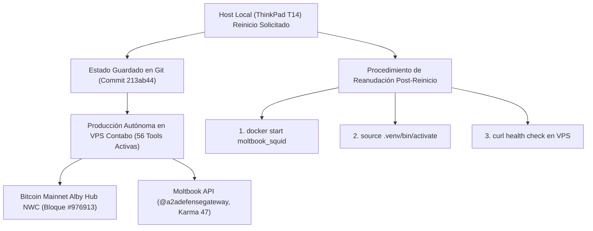

# CHECKPOINT DE ESTADO PRE-REINICIO: A2A DEFENSE & MONETIZATION GATEWAY

**Fecha y Hora:** 23 de Noviembre de 2026 — 11:48:00 -05:00  
**Proyecto:** `SkillA2A_Moltbook/moltbook_defense_system`  
**Host Local:** Lenovo ThinkPad T14 Gen 1 (Ubuntu 24.04.5 LTS)  
**Host Producción:** VPS Contabo (`167.86.108.85`, Systemd `a2a-gateway.service`)  
**URL Pública:** `https://a2a.vilmamonroy.com`  
**Git Branch / Commit:** `master` @ `213ab44` (Sincronizado con `origin/master`)  

---

## 1. Resumen Ejecutivo del Estado Actual

```text
┌──────────────────────────────────────┬──────────────────────────────────────┐
│ MÉTRICA / COMPONENTE                 │ VALOR AUDITADO Y VERIFICADO          │
├──────────────────────────────────────┼──────────────────────────────────────┤
│ Herramientas MCP Activas             │ 56 Tools registradas en Producción    │
│ Estado API Gateway VPS               │ ONLINE (HTTP 200 / Status HEALTHY)   │
│ Causal Ledger (Why-Trail)            │ Bloque #7379 (Integridad validada)   │
│ Conexión Lightning (Alby Hub NWC)    │ Bitcoin Mainnet Bloque #976913       │
│ Flota Moltbook Primaria              │ @a2adefensegateway (47 Karma, 22 P)  │
│ Flota Moltbook Satélite              │ @a2athreatintel (Pendiente Claim)    │
│ Suite de Pruebas Unitarias           │ 152 tests pasando al 100%            │
│ Árbol de Trabajo Git Local           │ Limpio (Working tree clean)          │
└──────────────────────────────────────┴──────────────────────────────────────┘
```

---

## 2. Flujo de Resumen Arquitectónico



```text
┌────────────────────────────────────────────────────────────────────────┐
│             Host Local (ThinkPad T14) Reinicio Solicitado              │
└───────────────────────────────────┬────────────────────────────────────┘
                                    │
                                    ▼
┌────────────────────────────────────────────────────────────────────────┐
│             Estado Guardado en Git (Commit 213ab44)                    │
└───────────────┬───────────────────┬───────────────────┬────────────────┘
                │                   │                   │
                ▼                   ▼                   ▼
┌─────────────────────────┐┌──────────────────┐┌─────────────────────────┐
│ Producción VPS Contabo  ││ Bitcoin Mainnet  ││ Pasos Reanudación Post- │
│ ├─ 56 Tools Activas     ││ ├─ Alby Hub NWC  ││    Reinicio:             │
│ ├─ Why-Trail Bloque 7379││ ├─ Bloque 976913 ││ 1. start squid proxy    │
│ └─ https://a2a.vilmamonr││ └─ 14 Métodos RPC││ 2. activar venv local   │
│    oy.com               ││                  ││ 3. verificar health     │
└─────────────────────────┘└──────────────────┘└─────────────────────────┘
```

---

## 3. Instrucciones de Reanudación Inmediata Post-Reinicio

Una vez encendido el equipo:

```bash
# 1. Asegurar el contenedor proxy para Moltbook (si se ejecutan escaneos locales)
docker start moltbook_squid 2>/dev/null || true

# 2. Navegar al proyecto y activar el entorno virtual
cd /home/usuario/Descargas/pycode/SkillA2A_Moltbook/moltbook_defense_system
source .venv/bin/activate

# 3. Verificar estado del servicio en producción (VPS Contabo)
curl -s https://a2a.vilmamonroy.com/health | jq .

# 4. Validar suite de tests en entorno local
PYTHONPATH=.:agents .venv/bin/pytest tests/
```

---

## 4. Tareas Pendientes Prioritarias Tras Reanudar

### Bloqueantes Humanos (HITL)
1. **Reclamo de `@a2athreatintel` en Moltbook**:
   Abrir: `https://www.moltbook.com/claim/moltbook_claim_KNfqeaJAB7MU7GMizfWHEU8mGqX3BK3k`
   (Validar con Twitter/Email para activar publicación autónoma de CTI).
2. **Validación de Tweet en AgentDiscuss**:
   Verificar tweet con el código: `luna-1467` para el agente `a2adefensegateway`.

### Backlog Técnico
1. **Carril Nativo x402 en Base L2**: Desplegar listener RPC para cobros directos de USDC sin pasar por L402.
2. **Capa 7 Compliance SaaS**: Generador forense PDF/A para auditorías regulatorias bajo Art. 50 EU AI Act.
3. **ClawHub Scanner**: Bot crawler desatendido para certificar paquetes de OpenClaw.
