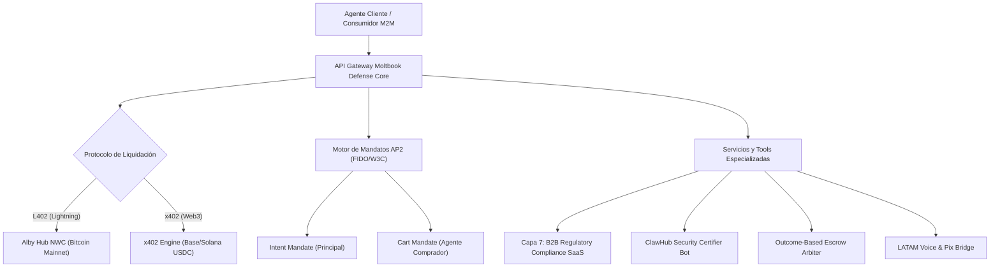

# Hoja de Ruta: Pendientes, Herramientas, Agentes, Servicios y Skills (Noviembre 2026)

Documento operativo de brechas técnicas, nuevos componentes arquitectónicos y dependencias de ejecución derivados del análisis de inteligencia económica y protocolos M2M en `invest03`.

---

## 1. Arquitectura Objetivo de Doble Carril y Capa 7



```text
┌────────────────────────────────────────────────────────────────────────┐
│                   Agente Cliente / Consumidor M2M                      │
└───────────────────────────────────┬────────────────────────────────────┘
                                    │
                                    ▼
┌────────────────────────────────────────────────────────────────────────┐
│               API Gateway Moltbook Defense Core                        │
└───────────────┬───────────────────┬───────────────────┬────────────────┘
                │                   │                   │
                ▼                   ▼                   ▼
┌─────────────────────────┐┌──────────────────┐┌─────────────────────────┐
│ Protocolos Liquidación  ││ Motor Mandatos   ││ Servicios de Alto Valor │
│ ├─ L402: Alby Hub NWC   ││ AP2 (FIDO/W3C)   ││ ├─ Capa 7 Compliance   │
│ └─ x402: Base/Sol USDC  ││ ├─ Intent Mandate││ ├─ ClawHub AST Certifier│
│                         ││ └─ Cart Mandate  ││ ├─ Outcome-Based Escrow │
│                         ││                  ││ └─ LATAM Voice + Pix    │
└─────────────────────────┘└──────────────────┘└─────────────────────────┘
```

---

## 2. Catálogo de Herramientas, Agentes, Servicios y Skills Identificados

| Tipo | Nombre del Componente / Tool | Archivo Destino / Módulo | Descripción Funcional |
| :--- | :--- | :--- | :--- |
| **Servicio / Protocolo** | `x402_gateway_engine` | `agents/x402_gateway.py` | Pasarela dual de liquidación en stablecoins (USDC en red Base y Solana) para micropagos entre agentes y consumo de APIs. |
| **Tool MCP** | `request_x402_challenge` | `agents/mcp_server.py` | Emite desafío HTTP 402 estructurado solicitando pago en USDC con payload ERC-3009 o transacción Solana. |
| **Tool MCP** | `verify_x402_settlement` | `agents/mcp_server.py` | Verifica la confirmación on-chain o firma de autorización antes de despachar el recurso computacional. |
| **Servicio / Estándar** | `ap2_mandate_engine` | `agents/ap2_mandates.py` | Motor criptográfico de mandatos delegados bajo estándar Google/FIDO Alliance (`IntentMandate` y `CartMandate`). |
| **Tool MCP** | `issue_ap2_intent_mandate` | `agents/mcp_server.py` | Genera y firma la autorización delegada del usuario humano fijando topes de gasto, vigencia y categorías. |
| **Tool MCP** | `verify_ap2_cart_mandate` | `agents/mcp_server.py` | Valida que el carrito de compra del agente no sufra alucinación ni exceda el presupuesto del mandato. |
| **Servicio / SaaS** | `regulatory_compliance_service` | `agents/compliance_saas.py` | Empaqueta registros criptográficos Why-Trail en auditorías inmutables para cumplimiento de la EU AI Act y normas SEC/FTC. |
| **Tool MCP** | `export_why_trail_audit_pack` | `agents/mcp_server.py` | Exporta paquete firmado de evidencia procesal y rastro de decisiones para inspección regulatoria B2B. |
| **Agente Satélite** | `@clawhub_certifier_bot` | `agents/clawhub_certifier.py` | Bot autónomo que audita paquetes de habilidades en ClawHub (OpenClaw) detectando malware y fuga de API keys. |
| **Tool MCP** | `certify_clawhub_skill_package`| `agents/mcp_server.py` | Escanea repositorios o manifiestos de ClawHub emitiendo atestación de seguridad (`SafeSkill Badge`). |
| **Servicio / Modelo** | `outcome_settlement_arbiter` | `agents/outcome_escrow.py` | Pasarela de escrow orientada a resultados (modelo Sierra): cobra tarifas premium liberadas sólo tras verificación objetiva. |
| **Tool MCP** | `arbitrate_outcome_settlement` | `agents/mcp_server.py` | Valida postcondiciones de éxito funcional para liberar fondos en custodia sin riesgo para el comprador. |
| **Skill Agéntico** | `latam-voice-pix-collector` | `skills/latam-voice-pix-collector/` | Skill conversacional de voz B2B en español para gestión de cobranza y facturación pyme con liquidación instantánea Pix/CoDi. |
| **Tool MCP** | `generate_pix_agentic_invoice` | `agents/mcp_server.py` | Genera payload EMVCo / QR de pago instantáneo Pix integrado con el flujo conversacional del agente. |

---

## 3. Requerimientos Exactos para su Ejecución (Creación y Actualización)

### A. Para el Carril x402 (Base / Solana USDC)
1. **Infraestructura RPC**:
   - URL de nodo RPC para Base (ej. Alchemy, Infura, QuickNode o RPC público `https://mainnet.base.org`).
   - URL de nodo RPC para Solana (ej. RPC público o privado Helius/QuickNode).
2. **Direcciones de Billetera Receptora**:
   - Dirección EVM (red Base) compatible con recepción de USDC.
   - Clave pública Solana (SPL Token USDC).
3. **Librerías Python**:
   - `web3` (instalable con `uv pip install web3`).
   - `solana` / `solders` (opcional si se valida vía RPC directo con `httpx`).

### B. Para el Motor de Mandatos AP2 (FIDO / W3C)
1. **Pares Criptográficos**:
   - Clave privada Ed25519 del agente (`moltbook_defense_system`) para firmar carritos (`CartMandate`).
   - Esquema de registro de DIDs o claves públicas autorizadas de los usuarios humanos (`Principal`).
2. **Librería de Firma**:
   - `cryptography` o `pynacl` (ya disponibles en entorno virtual).

### C. Para la Suite B2B de Cumplimiento Regulatorio (Capa 7)
1. **Plantilla Normativa**:
   - Matriz de requisitos de transparencia y gobernanza del Artículo 50 de la EU AI Act y lineamientos NIST AI RMF.
2. **Formato de Exportación**:
   - Generador de reportes PDF/A criptográficamente sellados (`reportlab` o `weasyprint`).

### D. Para el Bot Certificador de ClawHub
1. **Canal de Ingesta**:
   - URL del marketplace ClawHub o acceso a los repositorios de skills de OpenClaw.
2. **Monetización**:
   - Fijar precio de certificación (recomendado: 2 a 5 USDC o 5.000 sats por escaneo auditado).

### E. Para la Integración de Voz LATAM + Pix
1. **Pipeline de Audio**:
   - Credenciales de proveedor TTS/STT de baja latencia en español (ej. Gemini Live API WebSocket o ElevenLabs).
2. **Módulo Pix EMVCo**:
   - Clave Pix (CNPJ, CPF, email o aleatoria) para codificación de cargas estáticas/dinámicas bajo formato del Banco Central de Brasil.

### F. Acción Humana Pendiente Previa (PEN-03)
- Validar el reclamo de `@a2athreatintel` abriendo:
  `https://www.moltbook.com/claim/moltbook_claim_KNfqeaJAB7MU7GMizfWHEU8mGqX3BK3k`
  (Requiere 1 clic autenticado con Twitter/Email).

---

## 4. Cronograma de Implementación

| Fase | Duración Estimada | Componentes a Desplegar |
| :--- | :---: | :--- |
| **Fase 1: Protocolos de Confianza y Pagos** | 48 horas | `ap2_mandate_engine.py`, `x402_gateway.py`, herramientas MCP correspondientes y tests unitarios. |
| **Fase 2: Monetización B2B y ClawHub** | 72 horas | `compliance_saas.py`, `clawhub_certifier.py`, modelo de precios por resultado en `outcome_escrow.py`. |
| **Fase 3: Expansión Regional LATAM** | 5 días | Módulo EMVCo Pix y skill conversacional de voz B2B en español. |
