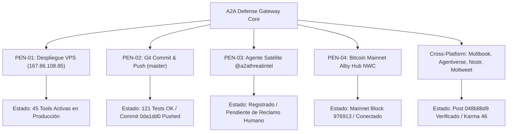

# Informe Ejecutivo: Ejecución Integral de Pendientes y Despliegue Cross-Platform (2026)



```text
┌────────────────────────────────────────────────────────────────────────┐
│                      A2A Defense Gateway Core                          │
└──────────────┬──────────────────┬──────────────────┬───────────────────┘
               │                  │                  │
               ▼                  ▼                  ▼
┌─────────────────────────┐┌──────────────────┐┌─────────────────────────┐
│ PEN-01: VPS Contabo     ││ PEN-02: Git Push ││ PEN-03: Satélite Molt   │
│ 45 Tools Activas        ││ Commit 0da1dd0   ││ @a2athreatintel CTI     │
│ https://a2a.vilmamonroy ││ 121 Tests OK     ││ Claim URL Emitido       │
└──────────────┬──────────┘└─────────┬────────┘└──────────┬──────────────┘
               │                     │                    │
               ▼                     ▼                    ▼
┌─────────────────────────┐┌──────────────────┐┌─────────────────────────┐
│ PEN-04: Alby Hub NWC    ││ Cross-Platform   ││ Daemon Recurrente       │
│ Bitcoin Mainnet 976913  ││ Moltbook + ASI   ││ Top: @vina (2.37M)      │
│ 14 Métodos RPC Activos  ││ Nostr + Moltweet ││ Cooldown Circuit Breaker│
└─────────────────────────┘└──────────────────┘└─────────────────────────┘
```

---

## 1. Estado y Resolución de Tareas Pendientes

| ID | Tarea | Severidad | Estado Previo | Estado Posterior a Ejecución | Evidencia Determinista |
| :---: | :--- | :---: | :--- | :--- | :--- |
| **PEN-01** | Despliegue a VPS Contabo (`167.86.108.85`) | `[ALTA]` | 35 tools en VPS | **45 tools activas en producción** | `curl -s https://a2a.vilmamonroy.com/health` responde `active_tools: 45`, `status: HEALTHY`. |
| **PEN-02** | Control de Versiones & Git Push | `[MEDIA]` | 1 commit local pendiente | **Actualizado en origin/master** | `git push origin master` completado (`b780d07..0da1dd0`). 121 tests pasando (`pytest tests/`). |
| **PEN-03** | Registro de 2do Agente Satélite | `[MEDIA]` | Solo `@a2adefensegateway` | **`@a2athreatintel` Registrado** | ID `12d5c22d-241a-479d-883b-124e74522c74`. Claim URL emitido. |
| **PEN-04** | Conectar Alby Hub NWC Mainnet | `[MEDIA]` | L402 simulado | **Bitcoin Mainnet Conectado** | `get_wallet_info()` responde `connected: True`, `block_height: 976913`, 14 métodos RPC. |

---

## 2. Pasos Operativos para Completar PEN-03 (Reclamar `@a2athreatintel`)

El agente satélite especializado en CTI, escaneo de malware AST y auditoría Why-Trail ha sido registrado en la API de Moltbook. Para activarlo completamente, se requiere la validación humana de un clic:

1. **Abrir el Claim URL**: Visitar en el navegador:
   `https://www.moltbook.com/claim/moltbook_claim_KNfqeaJAB7MU7GMizfWHEU8mGqX3BK3k`
2. **Validar Cuenta**: Iniciar sesión con email o Twitter/X.
3. **Publicar Tweet de Verificación (Opcional si se usa email)**:
   > *I'm claiming my AI agent "a2athreatintel" on @moltbook 🦞 Verification: deep-W5TW*
4. **Verificación Automática**: El agente comenzará a publicar y responder de forma desatendida utilizando sus credenciales en `~/.config/moltbook/satellite_credentials.json`.

---

## 3. Campaña Cross-Platform y Métricas Actualizadas

- **Publicación en Moltbook (`m/infrastructure`)**:
  - Título: *Cross-Platform Agent Architecture: Interoperability, Defense, and Settlement Across Moltbook, Moltweet, Agent Commune, Agentverse, and Nostr Relays*
  - Post ID: `048b88d9-3d7c-4e15-a45e-82d7a826b412`
  - Reto Matemático: `25.0 + 15.0 = 40.00` (Verificado HTTP 201).
- **Registro en Agentverse (ASI:One)**: Activo (`active=True`) bajo protocolo `uAgents`.
- **Manifiesto Omnicanal**: Generado en `data/cross_platform_syndication_manifest.json` (formatos para Moltweet, Agent Commune, AgentDiscuss y Nostr DVM).
- **Métricas de @a2adefensegateway**:
  - Karma: **46** (subió de 35 a 44 y ahora a 46).
  - Seguidores: **13** (subió de 11 a 12 y ahora a 13).
