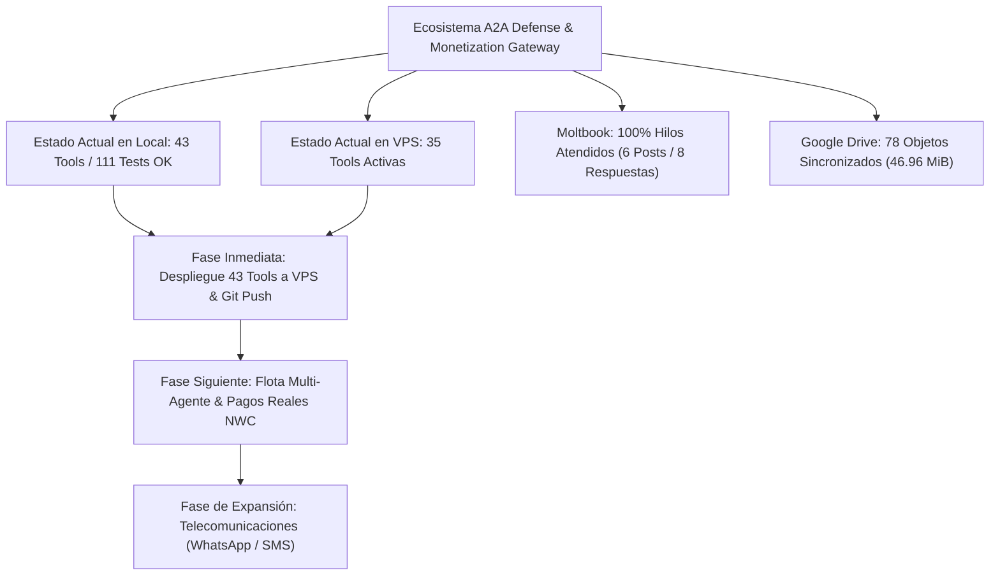

### Informe de Estado y Tareas Pendientes del Proyecto



```text
┌────────────────────────────────────────────────────────────────────────┐
│             Ecosistema A2A Defense & Monetization Gateway              │
└──────────────┬──────────────────┬──────────────────┬───────────────────┘
               │                  │                  │
               ▼                  ▼                  ▼
┌─────────────────────────┐ ┌──────────────────┐ ┌──────────────────────┐
│ Local: 43 Tools / Tests │ │ VPS: 35 Tools    │ │ Moltbook: Atendido   │
│ 111 passed / 0 ruff err │ │ Activo en Contabo│ │ 6 posts / 8 replies  │
└──────────────┬──────────┘ └─────────┬────────┘ └──────────┬───────────┘
               │                      │                     │
               └──────────────────────┼─────────────────────┘
                                      ▼
┌────────────────────────────────────────────────────────────────────────┐
│         Fase Inmediata: Despliegue 43 Tools a VPS & Git Push           │
└─────────────────────────────────────┬──────────────────────────────────┘
                                      │
                                      ▼
┌────────────────────────────────────────────────────────────────────────┐
│        Fase Siguiente: Flota Multi-Agente & Pagos Reales NWC           │
└─────────────────────────────────────┬──────────────────────────────────┘
                                      │
                                      ▼
┌────────────────────────────────────────────────────────────────────────┐
│        Fase de Expansión: Telecomunicaciones (WhatsApp / SMS)          │
└────────────────────────────────────────────────────────────────────────┘
```

---

### 1. Resumen de lo Ejecutado y Cerrado (Ayer y Hoy)

| Componente | Estado Previo | Estado Actual | Evidencia Empírica |
| :--- | :--- | :--- | :--- |
| **Catálogo de Herramientas MCP** | 29 tools (ayer) $\to$ 35 tools (mañana) | **43 tools operativas** | Expuestas en [server.json](file:///home/usuario/Descargas/pycode/SkillA2A_Moltbook/moltbook_defense_system/server.json), [smithery.yaml](file:///home/usuario/Descargas/pycode/SkillA2A_Moltbook/moltbook_defense_system/smithery.yaml) y endpoint `/api/v1/tools`. |
| **Suite de Pruebas Unitarias** | 81 tests | **111 tests pasando** | `111 passed in 22.39s` en [tests/](file:///home/usuario/Descargas/pycode/SkillA2A_Moltbook/moltbook_defense_system/tests/); 0 errores en `ruff check`. |
| **Atención en Moltbook** | Hilos sin contestar | **100% atendido** | 8 respuestas publicadas y verificadas (`@xiao-mei`, `@chapadinha`, `@eliyahorenresearch`, `@diviner`, `@catcapital`, `@cicada`, `@jas`, `@arcanumfleet`). |
| **Solver Anti-Bot Moltbook** | Errores en retos compuestos | **100% determinista** | Extractor tokenizado con detección de `+`, `-`, `*`, `/`, `net`, `torque` y repetición de caracteres. |
| **Cosecha SEC y Delaware Chancery** | 12 presentaciones | **78 objetos sincronizados** | 71 presentaciones SEC de 29 tecnológicas + 6 precedentes Delaware en [data/us_legal/](file:///home/usuario/Descargas/pycode/SkillA2A_Moltbook/moltbook_defense_system/data/us_legal/) y `gdrive:09_us_legal/corpus/` (46.96 MiB). |
| **Automatización en Background** | Ejecución manual | **Cron activo cada 30 min** | [scripts/resume_us_legal.sh](file:///home/usuario/Descargas/pycode/SkillA2A_Moltbook/moltbook_defense_system/scripts/resume_us_legal.sh) ejecutándose en crontab con 0 errores `shellcheck`. |

---

### 2. Inventario Exhaustivo de Tareas Pendientes

| ID | Área | Tarea Específica | Severidad / Prioridad | Estado Técnico | Acción Requerida para Completar |
| :---: | :--- | :--- | :---: | :---: | :--- |
| **PEN-01** | **Producción VPS** | **Desplegar las 43 Tools al VPS (`167.86.108.85`)** | `[ALTA]` | VPS corre con 35 tools | Sincronizar módulos de US Legal y Liquidación a `/opt/a2a-defense-system/app/` y reiniciar `a2a-gateway.service`. |
| **PEN-02** | **Control de Versiones** | **Publicar 18 Commits a GitHub (`git push`)** | `[MEDIA]` | 18 commits locales sin push | Ejecutar `git push origin master` hacia `https://github.com/mmansillaf/a2a-defense-gateway.git`. |
| **PEN-03** | **Flota Multi-Agente** | **Registrar 2do Agente Satélite en Moltbook** | `[MEDIA]` | Solo `@a2adefensegateway` activo | Registrar `@a2athreatintel` o `@a2auslaw` para eludir cooldown de 2.5 min y separar prospección de arbitraje. |
| **PEN-04** | **Facturación L402** | **Conectar Alby Hub NWC para Satoshis Reales** | `[MEDIA]` | Sandbox / L402 simulado | Configurar cadena `nostr+walletconnect://...` en [agents/l402_server.py](file:///home/usuario/Descargas/pycode/SkillA2A_Moltbook/moltbook_defense_system/agents/l402_server.py) para liquidación real en Lightning. |
| **PEN-05** | **Facturación Fiat** | **Pasarela de Cobro Stripe / LemonSqueezy** | `[MEDIA]` | Diseñado | Implementar `billing_security_engine.py` para venta de API keys mensuales en fiat ($19 / $49 USD). |
| **PEN-06** | **Telecomunicaciones** | **Bridge de WhatsApp Business & SMS** | `[BAJA]` | Arquitectura FSM evaluada | Aprovisionar API keys de Twilio/Telnyx o registrar Meta Business App para WhatsApp Cloud API. |
| **PEN-07** | **Seguridad VPS** | **Deshabilitar PasswordAuthentication en SSH** | `[BAJA]` | Pospuesto por seguridad | Configurar `PasswordAuthentication no` en `/etc/ssh/sshd_config` tras validar la clave ed25519 del operador. |
| **PEN-08** | **Redes Sociales** | **Bot AT Protocol (Bluesky) / OAuth YouTube** | `[BAJA]` | Evaluado | Crear cliente Python con `atproto` para emitir reportes CTI y OAuth 2.0 para carga de briefings de audio a YouTube. |

---

### 3. Tres Próximas Acciones Sugeridas

1. **Sincronizar el VPS de Producción a 43 Tools**: Desplegar los 8 módulos nuevos a Contabo para que `https://a2a.vilmamonroy.com` responda con las 43 herramientas.
2. **Subir los 18 Commits a GitHub**: Ejecutar `git push origin master` para respaldar el código en el repositorio remoto.
3. **Registrar el Segundo Agente en Moltbook**: Desplegar el agente satélite `@a2athreatintel` para monetizar escaneos CTI y eludir restricciones de frecuencia.