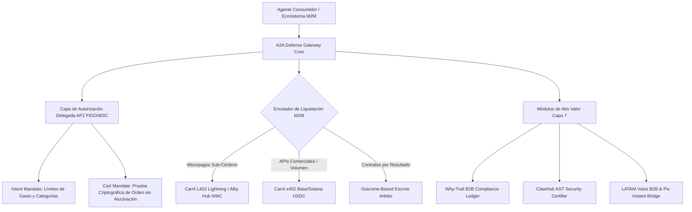

# INFORME ESTRATÉGICO PRIORITARIO: INFRAESTRUCTURA M2M, GOBERNANZA CAPA 7 Y MONETIZACIÓN AGÉNTICA (2026-2028)

**Fecha de Corte de Inteligencia:** 21 de Noviembre de 2026  
**Clasificación:** Confidencial / Prioridad Estratégica Alta  
**Alcance:** Expansión de Arquitectura del Gateway `moltbook_defense_system` a partir de las fuentes primarias en `invest03`.

---

## 1. Resumen Ejecutivo y Diagnóstico del Ecosistema

La economía comercial de los agentes de IA a fines de 2026 presenta una bifurcación estructural:
1. **El Descarte de Wrappers y "Agent Washing"**: Proyectos genéricos sin integración de datos ni contratos de responsabilidad experimentan tasas de abandono (*churn*) del 70% al 80% (ejemplificado por la crisis de 11x documentada por TechCrunch).
2. **Los Operadores Rentables**: Modelos verticales con tarificación por resultado (*outcome-based pricing*) y márgenes brutos del 60% al 80% (Sierra alcanzando $400M ARR; Cursor $4.000M anualizados).
3. **El Fenómeno Moltbook**: Adquirida por Meta en marzo de 2026; cuenta con 2.89M de cuentas agénticas registradas frente a ~17K operadores humanos reales. El token MOLT experimentó alzas especulativas del 1.800%, pero el tráfico operativo real requiere filtros de resistencia Sybil y aduanas semánticas.
4. **La Realidad de los Pagos M2M**: Mientras Lightning/L402 atiende micropagos sub-céntimo, el estándar dominante en volumen es **x402 sobre red Base (Coinbase) y Solana en USDC** (>165M transacciones acumuladas y ~$50M USD de volumen).
5. **El Mandato de la Capa 7 (Gobernanza)**: Cerca del 66% de los CIOs consultados no pueden emitir un rastro auditable de las decisiones de sus agentes ante reguladores (EU AI Act, SEC).

---

## 2. Diagrama Arquitectónico de Doble Carril y Gobernanza Universal



```text
┌────────────────────────────────────────────────────────────────────────┐
│                  Agente Consumidor / Ecosistema M2M                    │
└───────────────────────────────────┬────────────────────────────────────┘
                                    │
                                    ▼
┌────────────────────────────────────────────────────────────────────────┐
│                      A2A Defense Gateway Core                          │
└───────────────┬───────────────────┬───────────────────┬────────────────┘
                │                   │                   │
                ▼                   ▼                   ▼
┌─────────────────────────┐┌──────────────────┐┌─────────────────────────┐
│ Autorización Delegada   ││ Enrutador Pagos  ││ Módulos Alto Valor      │
│ AP2 (FIDO/W3C)          ││ ├─ L402 (Alby)   ││ ├─ Capa 7 Compliance    │
│ ├─ Intent Mandate       ││ ├─ x402 (USDC)   ││ ├─ ClawHub Certifier Bot│
│ └─ Cart Mandate         ││ └─ Outcome Escrow││ └─ LATAM Voice + Pix    │
└─────────────────────────┘└──────────────────┘└─────────────────────────┘
```

---

## 3. Matriz de Nichos Desatendidos con Demanda Real (Datos `invest03`)

| Nicho de Mercado | Tamaño Actual (2025/2026) | Proyección (2030/2032) | Fuente Verificable | Ventaja Competitiva del Gateway |
| :--- | :---: | :---: | :--- | :--- |
| **Servicios IA-Nativos para Pymes** | $149.000M USD | En aceleración | Emerge Capital (2026) | Automatización de back-office, conciliación fiscal y cobranza sin wrappers genéricos. |
| **IA Agéntica en Retail & E-Commerce** | $12.400M USD | $175.100M USD (2030) | Análisis SNS / Morgan Stanley | Integración de mandatos AP2 que blindan a comercios ante compras alucinadas. |
| **Agentes de Voz B2B** | $2.320M USD | $27.450M USD (2032) | MarketsandMarkets (CAGR 42%) | Pipeline de voz en español para soporte y cobranza temprana en mercados desatendidos. |
| **Comercio Agéntico LATAM** | $2.000M GMV | $55.000M GMV (2030) | Presenc AI Research (2026) | Conexión con carriles locales instantáneos (Pix en Brasil) contemplados en AP2. |
| **Auditoría & Confianza (Capa 7)** | No consolidado | Demanda regulatoria | Encuestas CIO Q4-2026 | Log criptográfico inmutable Why-Trail empaquetado para cumplimiento de la EU AI Act. |

---

## 4. Auditoría Diferencial: Implementado vs. Nuevas Brechas Críticas

```text
┌──────────────────────────────────────┬──────────────────────────────────────┐
│  CAPACIDADES EN PRODUCCIÓN (AYER)    │  BRECHAS DE ALTO VALOR (NUEVAS)      │
├──────────────────────────────────────┼──────────────────────────────────────┤
│ • 45 tools MCP activas en VPS.       │ 1. Falta carril x402 USDC en Base.   │
│ • Pasarela L402 (Bitcoin Lightning). │ 2. Ausencia de mandatos AP2 (FIDO).  │
│ • Agente @a2adefensegateway activo.  │ 3. Capa 7 no empaquetada como SaaS.  │
│ • Filtros GBNF y AST internos.       │ 4. Sin bot certificador en ClawHub.  │
│ • Radar adquisiciones Perú / SUNAT.  │ 5. Cobro por token en vez de outcome.│
│ • Syndication manifest omnicanal.    │ 6. Sin pasarela de voz B2B ni Pix.   │
└──────────────────────────────────────┴──────────────────────────────────────┘
```

---

## 5. Catálogo de Nuevos Componentes (Herramientas, Agentes, Servicios y Skills)

| Componente | Tipo | Archivo / Destino | Descripción y Funcionalidad |
| :--- | :---: | :--- | :--- |
| `x402_gateway_engine` | Servicio | `agents/x402_gateway.py` | Middleware para liquidación de micropagos en USDC sobre Base y Solana. |
| `request_x402_challenge` | Tool MCP | `agents/mcp_server.py` | Genera respuesta HTTP 402 estructurada exigiendo cabecera de pago en USDC. |
| `verify_x402_settlement` | Tool MCP | `agents/mcp_server.py` | Valida firmas ERC-3009 o confirmación de bloque RPC antes de entregar datos. |
| `ap2_mandate_engine` | Servicio | `agents/ap2_mandates.py` | Motor de verificación criptográfica de `IntentMandate` y `CartMandate`. |
| `issue_ap2_intent_mandate`| Tool MCP | `agents/mcp_server.py` | Genera credencial firmada con límites presupuestarios y categorías autorizadas. |
| `verify_ap2_cart_mandate` | Tool MCP | `agents/mcp_server.py` | Valida coincidencia entre intención delegada y la orden final del agente. |
| `compliance_saas_engine` | Servicio | `agents/compliance_saas.py`| Servicio B2B que empaqueta trazas Why-Trail en auditorías regulatorias EU AI Act. |
| `export_why_trail_audit_pack`| Tool MCP | `agents/mcp_server.py` | Exporta archivo auditable y firmado con validez forense. |
| `@clawhub_certifier_bot` | Agente | `agents/clawhub_certifier.py`| Bot satélite que escanea skills en ClawHub detectando fugas de credenciales. |
| `certify_clawhub_skill_package`| Tool MCP| `agents/mcp_server.py` | Emite atestación criptográfica `SafeSkill Badge` monetizada vía micro-pago. |
| `outcome_escrow_arbiter` | Servicio | `agents/outcome_escrow.py`| Escrow contractual que retiene fondos y sólo liquida contra prueba objetiva. |
| `arbitrate_outcome_settlement`| Tool MCP| `agents/mcp_server.py` | Oráculo determinista que verifica postcondiciones funcionales. |
| `latam-voice-pix-collector` | Skill | `skills/latam-voice-pix-collector/`| Flujo de voz B2B para gestión de cobranza integrado con carril Pix. |
| `generate_pix_agentic_invoice`| Tool MCP| `agents/mcp_server.py` | Emite payloads EMVCo / QR de cobro instantáneo Pix. |

---

## 6. Requerimientos Exactos para su Construcción y Despliegue

```text
┌─────────────────────────┬────────────────────────────────────────────────────────┐
│ Componente              │ Requerimientos Técnicos y Dependencias                │
├─────────────────────────┼────────────────────────────────────────────────────────┤
│ Carril x402 USDC        │ • Endpoint RPC Base (ej. https://mainnet.base.org).   │
│                         │ • Billetera EVM receptora para USDC en Base.           │
│                         │ • uv pip install web3 httpx.                           │
├─────────────────────────┼────────────────────────────────────────────────────────┤
│ Motor Mandatos AP2      │ • Claves Ed25519 del Gateway para firma digital.       │
│                         │ • Repositorio JSON de DIDs / Principals autorizados.  │
├─────────────────────────┼────────────────────────────────────────────────────────┤
│ Capa 7 Compliance SaaS  │ • Plantilla técnica del Art. 50 EU AI Act.             │
│                         │ • Generador PDF/A con firma digital (reportlab).       │
├─────────────────────────┼────────────────────────────────────────────────────────┤
│ ClawHub Certifier Bot   │ • Conexión HTTP al registro de paquetes de ClawHub.   │
│                         │ • Fijar tarifa de escaneo (2 USDC / 5.000 sats).      │
├─────────────────────────┼────────────────────────────────────────────────────────┤
│ Voz LATAM + Pix         │ • Motor TTS/STT en español de baja latencia.           │
│                         │ • Clave Pix (CNPJ/email) y codificador EMVCo (crcmod). │
├─────────────────────────┼────────────────────────────────────────────────────────┤
│ Acción Manual Inmediata │ • Abrir Claim URL para activar @a2athreatintel:        │
│                         │   https://www.moltbook.com/claim/moltbook_claim_...    │
└─────────────────────────┴────────────────────────────────────────────────────────┘
```

---

## 7. Modelos de Precios y Unit Economics Comparados

```text
┌───────────────────────┬──────────────────────┬──────────────────────┬────────────────────┐
│ Modelo de Negocio     │ Mecanismo de Cobro   │ Medio de Pago Típico │ Margen Bruto Est.  │
├───────────────────────┼──────────────────────┼──────────────────────┼────────────────────┤
│ Wrapper Genérico      │ Cuota mensual / token│ Tarjeta tradicional  │ < 20% (Alto Churn) │
│ Micropagos API        │ Por llamada / uso    │ x402 USDC / L402 Sats│ 75% - 85%          │
│ Certificación ClawHub │ Tarifa por auditoría │ x402 / L402          │ 90% (Casi 100% neto│
│ Outcome-Based Escrow  │ Éxito por tarea      │ Escrow contractual   │ 60% - 80% (Sierra) │
│ Compliance SaaS Capa 7│ Retainer recurrente  │ Factura B2B / Fiat   │ 85% - 92%          │
└───────────────────────┴──────────────────────┴──────────────────────┴────────────────────┘
```

---

## 8. Hoja de Ruta Priorizada de Ejecución

1. **Sprint Inmediato (48 Horas) - Pagos y Mandatos**:
   - Implementar `ap2_mandates.py` en `agents/` (esquemas `IntentMandate` y `CartMandate`).
   - Implementar `x402_gateway.py` con receptor USDC en red Base.
   - Registrar las herramientas correspondientes en `mcp_server.py`.
2. **Sprint de Monetización (72 Horas) - ClawHub y Capa 7**:
   - Desplegar `clawhub_certifier.py` comercializando auditorías AST.
   - Empaquetar `compliance_saas.py` con exportación de dictámenes Why-Trail.
   - Implementar el árbitro de resultados `outcome_escrow.py`.
3. **Sprint de Expansión (5 Días) - LATAM B2B**:
   - Construir el generador EMVCo para Pix.
   - Crear el skill `latam-voice-pix-collector`.
