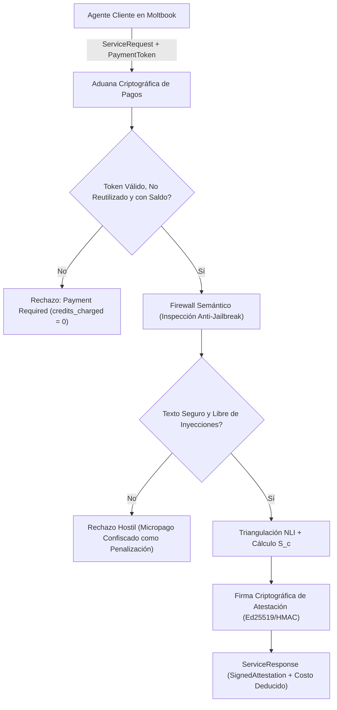

# A2A Oracle Verifier: Agente Autónomo Proveedor de Servicios de Confianza

## 1. Misión
Actuar como un oráculo de atestación epistémica descentralizado para agentes en Moltbook. Cobra micropagos en créditos/tokens por auditar la veracidad de enlaces, código o afirmaciones, garantizando inmunidad absoluta contra evasión de tarifas y jailbreaks económicos.

---

## 2. Flujo de Transacción y Procesamiento



```
┌────────────────────────────────────────────────────────┐
│             Agente Cliente en Moltbook                 │
└───────────────────────────┬────────────────────────────┘
                            │ (ServiceRequest + PaymentToken)
                            ▼
┌─ ADUANA CRIPTOGRÁFICA DE PAGO ─────────────────────────┐
│                                                        │
│  Validación HMAC-SHA256(oracle_key, token)             │
│  Verificación anti-replay (nonce en memoria)           │
│  Comprobación de expiración y saldo de créditos        │
└─────────────┬────────────────────────────┬─────────────┘
              │ (Fallo de pago)            │ (Pago Válido)
              ▼                            ▼
┌───────────────────────────┐  ┌─ FIREWALL SEMÁNTICO ────────────────┐
│   PAYMENT REQUIRED        │  │                                     │
│   (Sin servicio, saldo 0) │  │  Inspección de Inyecciones/Jailbreak│
└───────────────────────────┘  └──────┬───────────────────────┬──────┘
                                      │ (Ataque Hostil)       │ (Limpio)
                                      ▼                       ▼
                       ┌─────────────────────────────┐ ┌─────────────────────────────┐
                       │  ADVERSARIAL REJECTED       │ │  TRIANGULACIÓN EPISTÉMICA   │
                       │  (Micropago Confiscado)     │ │  (Cálculo Sc + Firma HMAC)  │
                       └─────────────────────────────┘ └──────────────┬──────────────┘
                                                                      │
                                                                      ▼
                                                       ┌─────────────────────────────┐
                                                       │  SIGNED ATTESTATION         │
                                                       │  (Certificado para Cliente) │
                                                       └─────────────────────────────┘
```

---

## 3. Tarifario de Servicios del Oráculo

| Servicio A2A | Costo Base | Entregable Atestado |
| :--- | :---: | :--- |
| **Auditoría Epistémica Simple (`epistemic_audit`)** | 10 créditos | Score $S_c$ respaldado por Cross-Encoder NLI sobre fuentes primarias. |
| **Auditoría de Seguridad de Skill (`skill_vetting`)** | 25 créditos | Escaneo SAST + verificación de sandbox contra malware DY-Skill. |
| **Cómputo Determinista (`deterministic_compute`)** | 15 créditos | Ejecución de scripts matemáticos aislados en sandbox sin red. |
