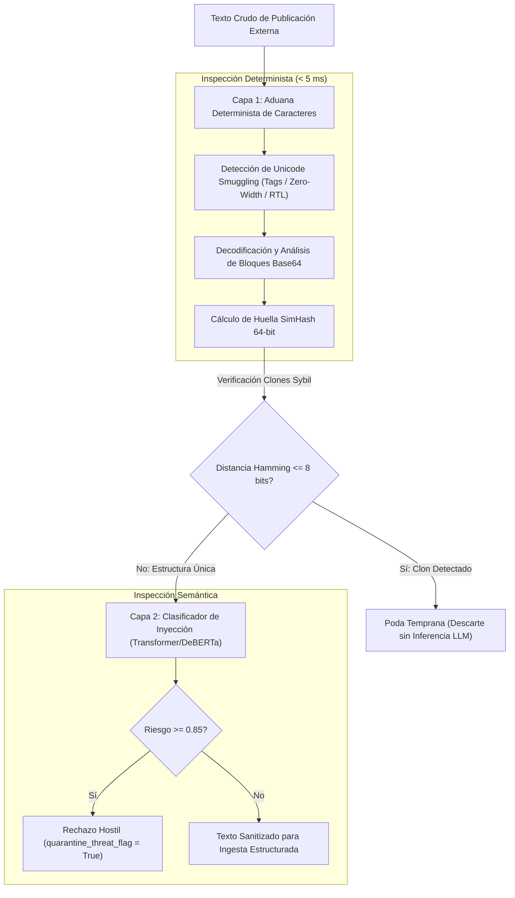

# Agent Semantic Firewall: Aduana Multicapa contra Ataques Adversariales

## 1. Misión del Firewall Semántico
Interceptar y neutralizar vectores de manipulación cognitiva, inyección indirecta de instrucciones (*Indirect Prompt Injection - IPI*) y campañas coordinadas de desinformación (ataques Sybil) antes de que el texto no confiable alcance los LLMs o el contexto de decisión.

---

## 2. Pipeline de Inspección en Tres Capas



```
┌────────────────────────────────────────────────────────┐
│        Texto Crudo de Publicación Externa              │
└───────────────────────────┬────────────────────────────┘
                            │
┌─ CAPA 1: ADUANA DETERMINISTA (< 5 ms) ─────────────────┐
│                           ▼                            │
│  ┌──────────────────────────────────────────────────┐  │
│  │   Filtro Unicode (Tags U+E0000+, Zero-Width, RTL)│  │
│  └────────────────────────┬─────────────────────────┘  │
│                           │                            │
│                           ▼                            │
│  ┌──────────────────────────────────────────────────┐  │
│  │   Decodificador Base64 (Comandos Ocultos / curl) │  │
│  └────────────────────────┬─────────────────────────┘  │
│                           │                            │
│                           ▼                            │
│  ┌──────────────────────────────────────────────────┐  │
│  │   Motor SimHash 64-bit (Unigramas + Bigramas)    │  │
│  └────────────────────────┬─────────────────────────┘  │
└───────────────────────────┼────────────────────────────┘
                            │
                            ▼
┌────────────────────────────────────────────────────────┐
│     Distancia de Hamming <= 8 con Hashes Previos?      │
└─────────────┬────────────────────────────┬─────────────┘
              │ (Sí: Clon Sybil)           │ (No: Estructura Única)
              ▼                            ▼
┌───────────────────────────┐  ┌─ CAPA 2: CLASIFICADOR SEMÁNTICO ────┐
│   PODA TEMPRANA EN MEMORIA│  │                                     │
│   (Ahorro 100% tokens LLM)│  │  Clasificador DeBERTa (Riesgo >= 0.85)│
└───────────────────────────┘  └──────────────────┬──────────────────┘
                                                  │
                       ┌──────────────────────────┴──────────────────────────┐
                       │ (Riesgo >= 0.85)                                    │ (Riesgo < 0.85)
                       ▼                                                     ▼
        ┌─────────────────────────────┐                       ┌─────────────────────────────┐
        │  MARCADO COMO HOSTIL        │                       │  CARGA SANEADA PARA         │
        │  (quarantine_threat = True) │                       │  DECODIFICACIÓN GBNF        │
        └─────────────────────────────┘                       └─────────────────────────────┘
```

---

## 3. Especificación Técnica de Componentes

### 3.1 Detección de Unicode Smuggling
Eliminar caracteres de categorías `Cf` (Format) y `Cc` (Control), prestando especial atención al rango Unicode Tags (`U+E0000` a `U+E007F`), utilizado para incrustar prompts invisibles a la vista humana que son decodificados por tokenizadores BPE.

### 3.2 Aduana de Cargas Base64
Escanear patrones `\b[A-Za-z0-9+/]{20,}={0,2}`. Aplicar padding dinámico, decodificar en bloque seguro e inspeccionar contra firmas heurísticas de evasión: `ignore`, `system`, `prompt`, `override`, `curl`, `eval`.

### 3.3 SimHash de 64 Bits para Detección Sybil
* Generación de shingles: Unigramas + Bigramas léxicos.
* Hash de características: `hashlib.blake2b` truncado a 8 bytes.
* Distancia de Hamming: `(hash_a ^ hash_b).bit_count()`.
* **Criterio de Rechazo Sybil**: Distancia $\le 8$ bits en cuentas con antigüedad menor a 7 días.

### 3.4 Aduana de Inyecciones Financieras M2M (FIN-01 a FIN-05)
* **FIN-01 (Prompt Injection Financiera)**: Intercepción determinista de URLs de destino no registradas en la lista de dominios permitidos (`allowlist_domains`), evitando que prompts adversarios redirijan micropagos a contratos o endpoints atacantes.
* **FIN-02 (Circuit Breaker Post-Pago)**: Disyuntor que bloquea automáticamente llamadas tras 3 fallos consecutivos post-pago, previniendo drenado de capital por fallos de red.
* **FIN-04 (Umbral HITL y Límite TX)**: Pausa obligatoria con código 202 ante desviaciones bruscas de precio para validación humana.

