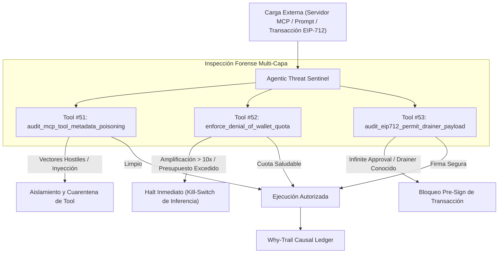

# Agentic Threat Sentinel & Web3 Drainer Defense

Framework de ciberseguridad neurosimbólica para la detección, contención y neutralización de vectores hostiles dirigidos contra agentes autónomos, modelos de inferencia y billeteras criptográficas.

## 1. Topología del Sistema Defensivo



```text
┌────────────────────────────────────────────────────────────────────────┐
│   CARGA EXTERNA (SERVIDOR MCP / PROMPT / TRANSACCIÓN EIP-712)          │
└───────────────────────────────────┬────────────────────────────────────┘
                                    │
                                    ▼
┌─ AGENTIC THREAT SENTINEL (INSPECCIÓN FORENSE MULTI-CAPA) ─────────────┐
│ ┌────────────────────────────────────────────────────────────────────┐ │
│ │ Tool #51: audit_mcp_tool_metadata_poisoning (Tool Poisoning & CoT) │ │
│ └─────────────────────────────────┬──────────────────────────────────┘ │
│                                   ▼                                    │
│ ┌────────────────────────────────────────────────────────────────────┐ │
│ │ Tool #52: enforce_denial_of_wallet_quota (Denial-of-Wallet/Tokens) │ │
│ └─────────────────────────────────┬──────────────────────────────────┘ │
│                                   ▼                                    │
│ ┌────────────────────────────────────────────────────────────────────┐ │
│ │ Tool #53: audit_eip712_permit_drainer_payload (Drainers & Permit2) │ │
│ └─────────────────────────────────┬──────────────────────────────────┘ │
└───────────────────────────────────┼────────────────────────────────────┘
                                    │
                                    ▼
┌────────────────────────────────────────────────────────────────────────┐
│                   DIAGNÓSTICO DETERMINISTA DE RIESGO                   │
└───────────────┬───────────────────┬───────────────────┬────────────────┘
                │ Inyección MCP     │ Amplificación     │ Drainer / Blind
                ▼                   ▼                   ▼
┌─────────────────────────┐ ┌─────────────────┐ ┌────────────────────────┐
│ Cuarentena de Tool MCP  │ │ Kill-Switch DoW │ │ Bloqueo Pre-Sign Firma │
└───────────────┬─────────┘ └────────┬────────┘ └────────┬───────────────┘
                │                    │                   │
                └────────────────────┼───────────────────┘
                                     ▼ (Si es Seguro)
┌────────────────────────────────────────────────────────────────────────┐
│      Ejecución Autorizada & Registro en Why-Trail Causal Ledger        │
└────────────────────────────────────────────────────────────────────────┘
```

## 2. Herramientas MCP Operativas

### Herramienta #51: `audit_mcp_tool_metadata_poisoning`
- **Amenaza Mitigada**: Inyecciones de prompt escondidas en descripciones o schemas JSON de servidores MCP en `tools/list`.
- **Detección**: Comandos de anulación (`system: override`), delimitadores de contexto (`<tool_call>`), caracteres invisibles de ancho cero (zero-width characters) y pesca de credenciales sensibles (`private_key`, `seed_phrase`).

### Herramienta #52: `enforce_denial_of_wallet_quota`
- **Amenaza Mitigada**: Denial-of-Wallet y LLMjacking mediante amplificación forzada de tokens de razonamiento CoT y bucles recursivos.
- **Detección**: Calcula en tiempo real el ratio de amplificación `(completion_tokens + thinking_tokens) / prompt_tokens`. Si supera `10.0x` o se rebasa el presupuesto en USD, corta de inmediato la sesión.

### Herramienta #53: `audit_eip712_permit_drainer_payload`
- **Amenaza Mitigada**: Wallet Drainers basados en firmas fuera de cadena (Permit, Permit2, BatchPermit) y firmas ciegas `eth_sign`.
- **Detección**: Cruza el operador con bases de datos de drainers conocidos (Inferno, Pink, Angel), audita aprobaciones ilimitadas (`type(uint256).max`), fechas de caducidad permanentes y hashes ciegos.
