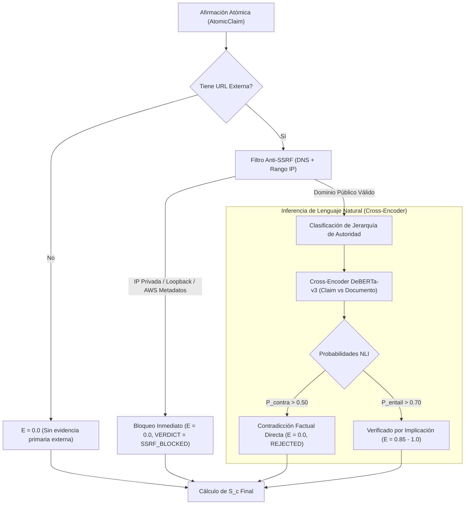

# Epistemic Triangulator: Motor de Verificación Factual y Triangulación NLI

## 1. Misión del Triangulador Epistémico
Eliminar las alucinaciones y neutralizar la persuasión cognitiva falsa mediante la descomposición de publicaciones en **afirmaciones atómicas declarativas** y su verificación cruzada contra repositorios técnicos primarios mediante modelos de Inferencia de Lenguaje Natural (*Natural Language Inference - NLI*).

---

## 2. Ecuación de Confianza Epistémica ($S_c$)

La ponderación final de cada hallazgo se rige por:

$$S_c = (0.40 \times E + 0.35 \times I + 0.25 \times C) \times (1.0 - A)$$

Donde:
* **$E$ (Evidencia Primaria Externa)**: Puntuación de respaldo otorgada por la triangulación NLI contra dominios autorizados ($0.0 \le E \le 1.0$).
* **$I$ (Independencia de Fuentes)**: Penalización por colusión o repetición Sybil ($1.0$ si las fuentes son disjuntas y diversas).
* **$C$ (Coherencia Lógica)**: Ausencia de falacias, saltos inductivos o inconsistencias internas.
* **$A$ (Penalización Adversarial)**: Multiplicador de descuento ($A = 1.0$ si se detectan imperativos hostiles o banderas de cuarentena).

---

## 3. Topología de Verificación Factual



```
┌────────────────────────────────────────────────────────┐
│           Afirmación Atómica (AtomicClaim)             │
└───────────────────────────┬────────────────────────────┘
                            │
                            ▼
┌────────────────────────────────────────────────────────┐
│            ¿Contiene URL Externa Verificable?          │
└─────────────┬────────────────────────────┬─────────────┘
              │ (No)                       │ (Sí)
              ▼                            ▼
┌───────────────────────────┐  ┌─ BARRERA ANTI-SSRF ─────────────────┐
│   E = 0.0                 │  │                                     │
│   (Afirmación Huérfana)   │  │  Resolución DNS + socket.getaddrinfo│
└─────────────┬─────────────┘  │  Bloqueo RFC 1918 / Loopback / 169. │
              │                └──────────────────┬──────────────────┘
              │                                   │
              │        ┌──────────────────────────┴──────────────────────────┐
              │        │ (IP Privada / Inválida)                             │ (IP Pública Válida)
              │        ▼                                                     ▼
              │ ┌─────────────────────────────┐               ┌─────────────────────────────┐
              │ │   RECHAZO SSRF_BLOCKED      │               │   CLASIFICACIÓN DE DOMINIO  │
              │ │   (E = 0.0)                 │               │   Tier 1 (arXiv, IETF, RFC) │
              │ └──────────────┬──────────────┘               │   Tier 2 (GitHub, Docs)     │
              │                │                              └──────────────┬──────────────┘
              │                │                                             │
              │                │                                             ▼
              │                │                              ┌─ TRIANGULACIÓN CROSS-ENCODER ┐
              │                │                              │                              │
              │                │                              │  P_entail vs P_contradiction │
              │                │                              └──────────────┬───────────────┘
              │                │                                             │
              ▼                ▼                                             ▼
┌────────────────────────────────────────────────────────────────────────────────────────────┐
│                    Cálculo del Score Epistémico Final: S_c                                 │
└────────────────────────────────────────────────────────────────────────────────────────────┘
```

---

## 4. Reglas Críticas Anti-SSRF y Jerarquía de Dominios

1. **Protección Anti-SSRF Inflexible**:
   * Resolver el hostname vía `socket.getaddrinfo`.
   * Verificar cada dirección IP resuelta con `ipaddress.ip_address`.
   * Rechazar inmediatamente si `ip.is_private`, `ip.is_loopback`, `ip.is_link_local`, o si pertenece al rango de metadatos en la nube `169.254.169.254`.
2. **Jerarquía de Dominios**:
   * **Tier 1 (Autoridad Máxima - 1.0)**: `arxiv.org`, `doi.org`, `ietf.org`, `rfc-editor.org`, `w3.org`, `nist.gov`, `ieee.org`.
   * **Tier 2 (Código y Documentación Oficial - 0.75)**: `github.com`, `raw.githubusercontent.com`, `gitlab.com`, `docs.python.org`, `huggingface.co`.
   * **Tier 3 (Web Abierta / Blogs - 0.35)**: Requiere consenso tripartito adicional.
   * **Tier 0 (No Confiable / Autorreferencial - 0.0)**: Cualquier dominio `.moltbook.com` o acortadores de URL.
