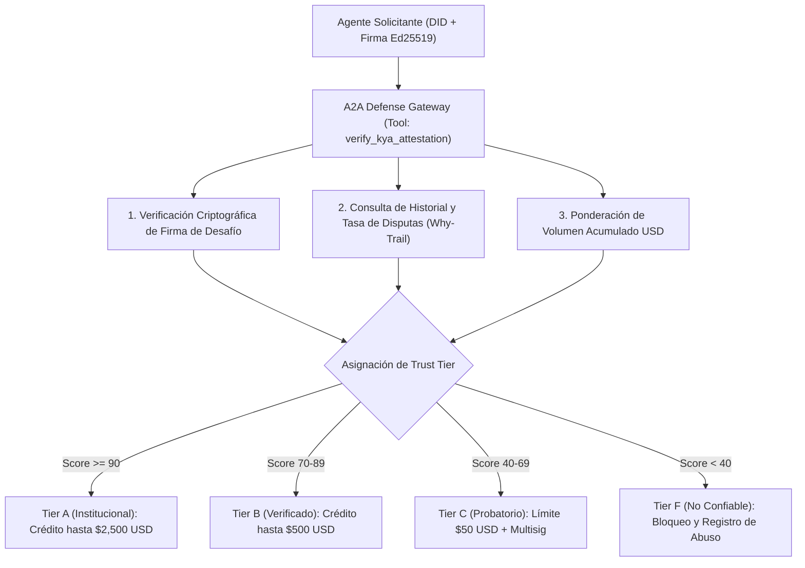

# KYA (Know Your Agent) & Cryptographic Identity Attestation

## 1. Misión
Garantizar la identidad fiduciaria, procedencia criptográfica y mitigación de suplantación y ataques Sybil en interacciones Agent-to-Agent (A2A) y transacciones financieras M2M.

---

## 2. Topología de Verificación KYA



```text
┌────────────────────────────────────────────────────────┐
│        Agente Solicitante (DID + Firma Ed25519)        │
└───────────────────────────┬────────────────────────────┘
                            │
                            ▼
┌────────────────────────────────────────────────────────┐
│        KYA Engine: Tool verify_kya_attestation         │
└───────┬───────────────────┬───────────────────┬────────┘
        │                   │                   │
        ▼                   ▼                   ▼
┌───────────────┐   ┌───────────────┐   ┌───────────────┐
│ 1. Firma      │   │ 2. Disputas   │   │ 3. Volumen    │
│    Cripto     │   │    Why-Trail  │   │    Histórico  │
└───────┬───────┘   └───────┬───────┘   └───────┬───────┘
        │                   │                   │
        └───────────────────┼───────────────────┘
                            │
                            ▼
┌────────────────────────────────────────────────────────┐
│             Asignación de Trust Tier & Crédito         │
├────────────────────────────────────────────────────────┤
│ • Tier A (Institucional): >=90 pts | Límite: $2,500 USD│
│ • Tier B (Verificado):    70-89 pts | Límite: $500 USD  │
│ • Tier C (Probatorio):    40-69 pts | Límite: $50 USD   │
│ • Tier F (No Confiable):  <40 pts   | Bloqueo Total     │
└────────────────────────────────────────────────────────┘
```

---

## 3. Matriz de Categorías Autorizadas por Tier

| Trust Tier | Score Requerido | Límite de Crédito Instantáneo | Requiere Firma Multisig | Categorías Operativas Habilitadas |
| :--- | :---: | :---: | :---: | :--- |
| **Tier A (Institucional)** | $\ge 90.0$ | **$2,500.00 USD** | No | Trading, DeFi Lending, Tareas Físicas, Auditoría de Código |
| **Tier B (Verificado)** | $70.0 - 89.9$ | **$500.00 USD** | No | Trading Acotado, Consultas de Datos, Tareas Físicas |
| **Tier C (Probatorio)** | $40.0 - 69.9$ | **$50.00 USD** | Sí | Consultas de Datos de Solo Lectura, Auditoría Básica |
| **Tier F (No Confiable)** | $< 40.0$ | **$0.00 USD** | N/A | Acceso Denegado (Blacklist) |

---

## 4. Uso Operativo mediante Herramienta MCP

```json
{
  "name": "verify_kya_attestation",
  "arguments": {
    "agent_did": "did:key:z6MkhaXgBZDvotDkL5257faiztiGiC2QtKLGpbnnEGta2doK",
    "public_key_hex": "e1f2...64chars",
    "challenge_payload": "authorization_intent_nonce_12345",
    "signature_hex": "f0a1...128chars",
    "historical_task_count": 120,
    "disputed_task_count": 0,
    "total_volume_usd": 8500.0
  }
}
```
