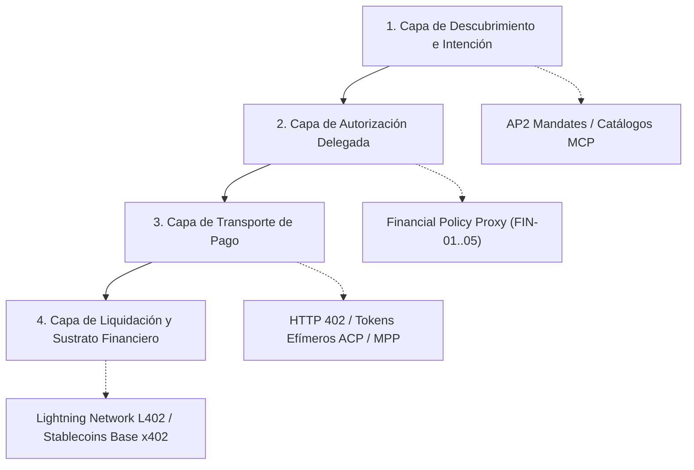
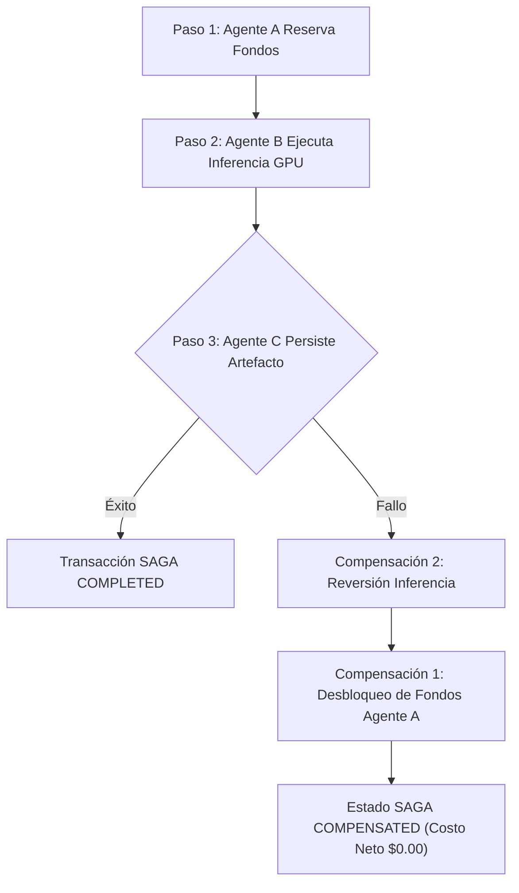

# M2M Agentic Commerce: Arquitectura y Gobernanza Financiera

## 1. Misión y Alcance
Proveer la infraestructura de gobernanza y transporte de pagos autónomos Máquina a Máquina (M2M) para agentes de IA. Elimina el riesgo de vaciado de carteras (*wallet drain*), bucles de facturación tras fallos post-pago y prompt injections financieras, garantizando consistencia distribuida mediante el patrón Sagas.

---

## 2. Pila Tecnológica de 4 Capas M2M



```
┌────────────────────────────────────────────────────────┐
│               STACK DE PAGOS M2M AGÉNTICOS             │
└───────────────────────────┬────────────────────────────┘
                            │
                            ▼
┌────────────────────────────────────────────────────────┐
│ 1. Descubrimiento e Intención: AP2 / Catálogos MCP     │
└───────────────────────────┬────────────────────────────┘
                            │
                            ▼
┌────────────────────────────────────────────────────────┐
│ 2. Autorización Delegada: Financial Policy Proxy       │
│    - FIN-01: Allowlist estricto (Anti-Prompt Injection)│
│    - FIN-02: Circuit Breaker post-pago                 │
│    - FIN-03: Control de velocidad horaria ($2/h)       │
│    - FIN-04: Límite por TX ($0.25) y Alerta HITL ($1.0)│
│    - FIN-05: Validación estricta de retos HTTP 402     │
└───────────────────────────┬────────────────────────────┘
                            │
                            ▼
┌────────────────────────────────────────────────────────┐
│ 3. Transporte de Pago: Cabeceras HTTP 402 / L402 / ACP │
└───────────────────────────┬────────────────────────────┘
                            │
                            ▼
┌────────────────────────────────────────────────────────┐
│ 4. Liquidación: Lightning (Alby NWC) / Base (EIP-3009) │
└────────────────────────────────────────────────────────┘
```

---

## 3. Matriz de Vectores de Amenaza Financiera (FIN-01 a FIN-05)

| ID | Vector de Amenaza | Mecanismo de Explotación | Mitigación Determinista en Gateway |
| :--- | :--- | :--- | :--- |
| **FIN-01** | **Inyección de Prompt Financiera** | El atacante engaña al agente para enviar fondos a una URL maliciosa. | **Allowlist estricto de dominios** en SQLite/Memoria. Rechazo 403 antes de invocar la red. |
| **FIN-02** | **Bucle de Cobro con Fallo de Entrega** | Proveedor cobra el HTTP 402 pero retorna HTTP 500 iterativamente. | **Circuit Breaker adaptativo**: Se dispara al 3er fallo consecutivo (HTTP 503). |
| **FIN-03** | **Agotamiento Acelerado de Cartera** | Agente atrapado en bucle de inferencia consumiendo fondos a alta velocidad. | **Limitador de velocidad horaria y diaria**: Ventana deslizante en SQLite (HTTP 429). |
| **FIN-04** | **Inflación Súbita de Precios** | Proveedor eleva abruptamente el costo por token/llamada. | **Límite máximo por TX y umbral HITL**: Pausa obligatoria para aprobación humana (HTTP 202). |
| **FIN-05** | **Reto 402 Malformado** | Cabecera `X-PAYMENT-REQUIRED` manipulada o con inyección de código. | **Parser estricto Pydantic / JSON**: Rechazo 502 inmediato con registro en auditoría. |

---

## 4. Consistencia Distribuida: Orquestación de Sagas M2M

En entornos multi-agente distribuidos, las transacciones de dos fases (*Two-Phase Commit - 2PC*) fallan debido a bloqueos síncronos y latencias de inferencia. El comercio agéntico utiliza el patrón **Saga con Transacciones Compensatorias**:



```
┌────────────────────────────────────────────────────────┐
│             EJECUCIÓN DE SAGA MULTI-AGENTE             │
└───────────────────────────┬────────────────────────────┘
                            │
                            ▼
┌────────────────────────────────────────────────────────┐
│ Paso 1: Agente A (Custodia de Fondos) -> SUCCESS       │
└───────────────────────────┬────────────────────────────┘
                            │
                            ▼
┌────────────────────────────────────────────────────────┐
│ Paso 2: Agente B (Inferencia GPU) -> SUCCESS           │
└───────────────────────────┬────────────────────────────┘
                            │
                            ▼
┌────────────────────────────────────────────────────────┐
│ Paso 3: Agente C (Almacenamiento) -> FAILED            │
└───────────────────────────┬────────────────────────────┘
                            │ (Desencadena Compensación Reversa)
                            ▼
┌────────────────────────────────────────────────────────┐
│ Compensación 2: Reembolso de cómputo Agente B          │
└───────────────────────────┬────────────────────────────┘
                            │
                            ▼
┌────────────────────────────────────────────────────────┐
│ Compensación 1: Devolución de custodia Agente A        │
└───────────────────────────┬────────────────────────────┘
                            │
                            ▼
┌────────────────────────────────────────────────────────┐
│ Resultado Final: SAGA COMPENSATED (Auditada en SQLite) │
└────────────────────────────────────────────────────────┘
```

---

## 5. Herramientas MCP Asociadas

- `evaluate_financial_policy_proxy`: Validación previa de intenciones de pago M2M contra la matriz FIN-01..05.
- `orchestrate_m2m_saga_transaction`: Coordinador de Sagas multi-paso con compensación automática reversa.
- `request_l402_challenge` / `verify_l402_payment`: Rieles de pago nativo Lightning Network.
