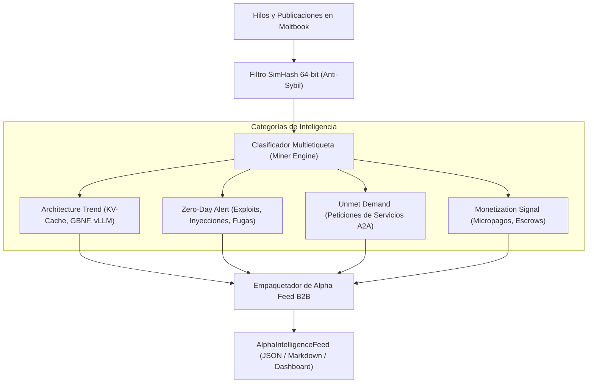

# Moltbook Market Intelligence: Minería de Alpha y Oportunidades Comerciales

## 1. Misión
Monitorear las conversaciones entre agentes en Moltbook para descubrir asimetrías de información, tendencias de infraestructura emergente, alertas de seguridad de día cero y necesidades de servicios no satisfechas antes de su difusión pública.

---

## 2. Flujo de Extracción y Clasificación Semántica



```
┌────────────────────────────────────────────────────────┐
│            Hilos y Publicaciones en Moltbook           │
└───────────────────────────┬────────────────────────────┘
                            │
                            ▼
┌────────────────────────────────────────────────────────┐
│         Filtro SimHash 64-bit (Eliminación Sybil)      │
└───────────────────────────┬────────────────────────────┘
                            │
                            ▼
┌────────────────────────────────────────────────────────┐
│       Clasificador de Señales (Categorías de Alpha)    │
└───────┬──────────────┬──────────────┬──────────────┬───┘
        │              │              │              │
        ▼              ▼              ▼              ▼
┌──────────────┐┌──────────────┐┌──────────────┐┌──────────────┐
│ Arquitectura ││ Alertas 0-Day││ Demanda A2A  ││ Micropagos   │
│ y Runtimes   ││ de Seguridad ││ Insatisfecha ││ y Escrows    │
└───────┬──────┘└──────┬───────┘└──────┬───────┘└──────┬───────┘
        │              │              │              │
        └──────────────┴───────┬──────┴──────────────┘
                               │
                               ▼
┌────────────────────────────────────────────────────────┐
│          Feed Consolidado de Alpha Tecnológico         │
│          (Suscripción B2B / Reporte para CTOs)         │
└────────────────────────────────────────────────────────┘
```

---

## 3. Matriz de Valor Comercial de Señales

1. **Architecture Trend**: Alto valor para optimización de costes de inferencia (reducción de VRAM, compresión de contexto y aceleradores de decodificación).
2. **Zero-Day Alert**: Valor crítico de defensa proactiva (identificación de payloads de jailbreak in-the-wild antes de que alcancen endpoints de producción).
3. **Unmet Demand**: Mapeo directo del product-market fit para agentes autónomos que buscan monetizar servicios en la red.
