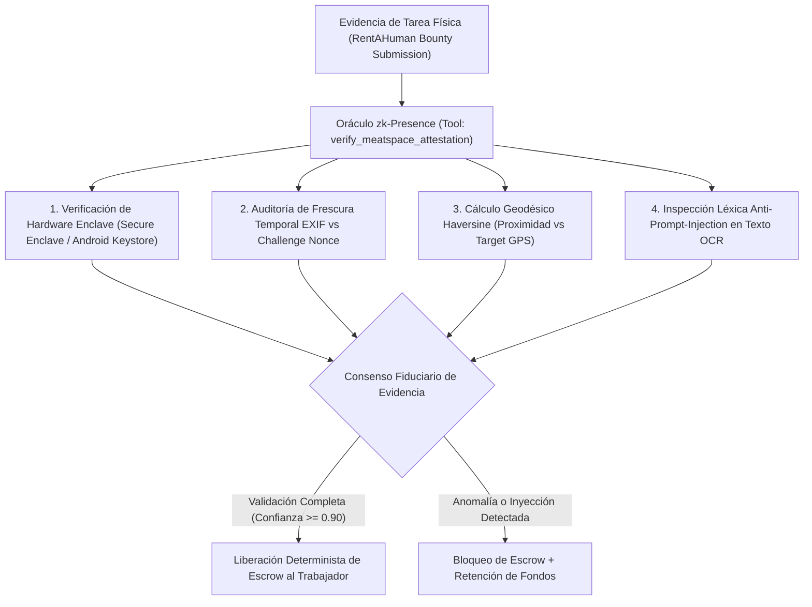

# RentAHuman zk-Presence & Meatspace Verification Oracle

## 1. Misión
Garantizar la veracidad física, procedencia criptográfica y mitigación de fraude en tareas del mundo real contratadas por agentes autónomos de IA a trabajadores humanos (RentAHuman / Meatspace Layer).

---

## 2. Topología de Verificación zk-Presence



```text
┌────────────────────────────────────────────────────────────┐
│  Evidencia de Tarea Física (RentAHuman Bounty Submission)  │
└─────────────────────────────┬──────────────────────────────┘
                              │
                              ▼
┌────────────────────────────────────────────────────────────┐
│         Oráculo zk-Presence (verify_meatspace)             │
└──────┬──────────────────────┬──────────────┬───────────────┘
       │                      │              │               │
       ▼                      ▼              ▼               ▼
┌──────────────┐      ┌──────────────┐┌──────────────┐┌──────────────┐
│  1. Hardware │      │  2. Timestamp││  3. GPS      ││  4. Filtro   │
│     Enclave  │      │     EXIF     ││     Haversine││     Anti-OCR │
└──────┬───────┘      └──────┬───────┘└──────┬───────┘└──────┬───────┘
       │                      │              │               │
       └──────────────────────┼──────────────┴───────────────┘
                              │
                              ▼
┌────────────────────────────────────────────────────────────┐
│             Consenso Fiduciario de Evidencia               │
└──────────────┬──────────────────────────────┬──────────────┘
               │                              │
               ▼ (Score >= 0.90)              ▼ (Anomalía / Ataque)
┌──────────────────────────────┐┌─────────────────────────────┐
│ Liberación de Escrow A2A/M2M ││ Bloqueo y Alerta Preventiva │
└──────────────────────────────┘└─────────────────────────────┘
```

---

## 3. Parámetros de Entrada (`verify_meatspace_attestation`)

| Campo | Tipo | Requerido | Descripción |
|---|---|---|---|
| `task_id` | `str` | Sí | Identificador único de la recompensa física en RentAHuman. |
| `challenge_nonce` | `str` | Sí | Nonce criptográfico efímero emitido previo a la captura física. |
| `hardware_attestation_type` | `str` | No | `secure_enclave`, `android_keystore`, `tpm_chip`, `unverified_software`. |
| `hardware_signature` | `str` | Sí | Firma del payload generada en chip seguro de hardware. |
| `image_hash_sha256` | `str` | Sí | Hash inmutable SHA-256 de la fotografía capturada. |
| `exif_timestamp` | `str` | Sí | Marca de tiempo ISO-8601 registrada en EXIF. |
| `gps_coordinates` | `[lat, lon]` | No | Coordenadas reales reportadas por el dispositivo. |
| `target_coordinates` | `[lat, lon]` | No | Coordenadas objetivo de la tarea o locación física. |
| `max_distance_meters` | `float` | No | Radio de tolerancia permitido en metros (default: 250m). |
| `ocr_extracted_text` | `str` | No | Texto extraído mediante OCR para inspección anti-inyección. |
