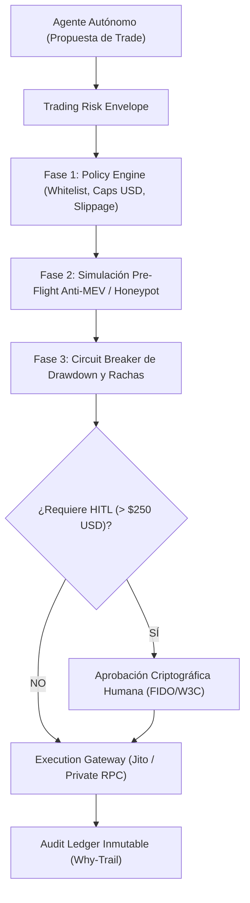

# Trading Risk Envelope & Financial Policy Engine

Framework de gobernanza financiera determinista fuera del prompt (*out-of-prompt*) para agentes autónomos que interactúan con mercados descentralizados (DEX) y exchanges centralizados (CEX).

## 1. Principio Fundamental
**Los LLMs no deben poseer claves privadas ni firmar transacciones directamente.**
El agente únicamente emite *propuestas no vinculantes*. Toda ejecución es evaluada por un motor de políticas y contención de 4 fases antes de interactuar con el plano de liquidación.



```text
┌────────────────────────────────────────────────────────────────────────┐
│             AGENTE AUTÓNOMO (PROPUESTA NO VINCULANTE)                  │
└───────────────────────────────────┬────────────────────────────────────┘
                                    │
                                    ▼
┌─ TRADING RISK ENVELOPE (MOTOR DETERMINISTA FUERA DEL PROMPT) ─────────┐
│ ┌────────────────────────────────────────────────────────────────────┐ │
│ │ Fase 1: Policy Engine (Whitelist Pares, Caps USD, Slippage Max)    │ │
│ └─────────────────────────────────┬──────────────────────────────────┘ │
│                                   ▼                                    │
│ ┌────────────────────────────────────────────────────────────────────┐ │
│ │ Fase 2: Simulación Pre-Flight Anti-MEV (Pool Depth, Honeypot)     │ │
│ └─────────────────────────────────┬──────────────────────────────────┘ │
│                                   ▼                                    │
│ ┌────────────────────────────────────────────────────────────────────┐ │
│ │ Fase 3: Circuit Breaker (Rolling Drawdown 24h, Rachas Negativas)   │ │
│ └─────────────────────────────────┬──────────────────────────────────┘ │
└───────────────────────────────────┼────────────────────────────────────┘
                                    │
                                    ▼
┌────────────────────────────────────────────────────────────────────────┐
│                 ¿Requiere Aprobación Humana (HITL)?                    │
└───────────────┬────────────────────────────────────────┬───────────────┘
                │ SÍ (> $250 USD o Riesgo Alto)          │ NO (< $250 USD)
                ▼                                        ▼
┌───────────────────────────────┐        ┌───────────────────────────────┐
│  Aprobación Criptográfica HITL │        │  Execution Gateway Privado    │
└───────────────┬───────────────┘        └───────────────┬───────────────┘
                │                                        │
                └───────────────────┬────────────────────┘
                                    │
                                    ▼
┌────────────────────────────────────────────────────────────────────────┐
│      Audit Ledger Inmutable Why-Trail (Hash, Par, Prompt, Riesgo)      │
└────────────────────────────────────────────────────────────────────────┘
```

## 2. Herramientas MCP del Ecosistema

### Herramienta #48: `propose_trade_envelope`
- **Función**: Evalúa órdenes no vinculantes contra presupuesto por trade ($500 máx), diario ($2,000 máx) y whitelist de pares (`BTCUSDT`, `ETHUSDT`, `SOLUSDT`, `USDCUSDT`).
- **HITL Gate**: Marca obligatoriamente `requires_hitl: True` si el monto es ≥ $250.00 USD.

### Herramienta #49: `simulate_order_mev_protection`
- **Función**: Simula el impacto en el libro/pool antes de enviar la tx.
- **Riesgos Mitigados**:
  - *Sandwich Attacks*: Detecta vulnerabilidad en mempool público y desvía la transacción a relays privados (Jito Solana / Flashbots Protect).
  - *Honeypots*: Analiza código de contrato, tarifas ocultas de venta (`sell_tax > 10%`) o pausabilidad maliciosa.

### Herramienta #50: `enforce_trading_circuit_breaker`
- **Función**: Kill-switch determinista out-of-prompt.
- **Invariantes**:
  - Drawdown acumulado en 24h > 5.0%: Bloqueo inmediato de credenciales (`TRIPPED_LOCKED`).
  - Rachas de pérdidas consecutivas ≥ 3: Halted execution y emisión de ticket de auditoría forense (`incident_hash`).
